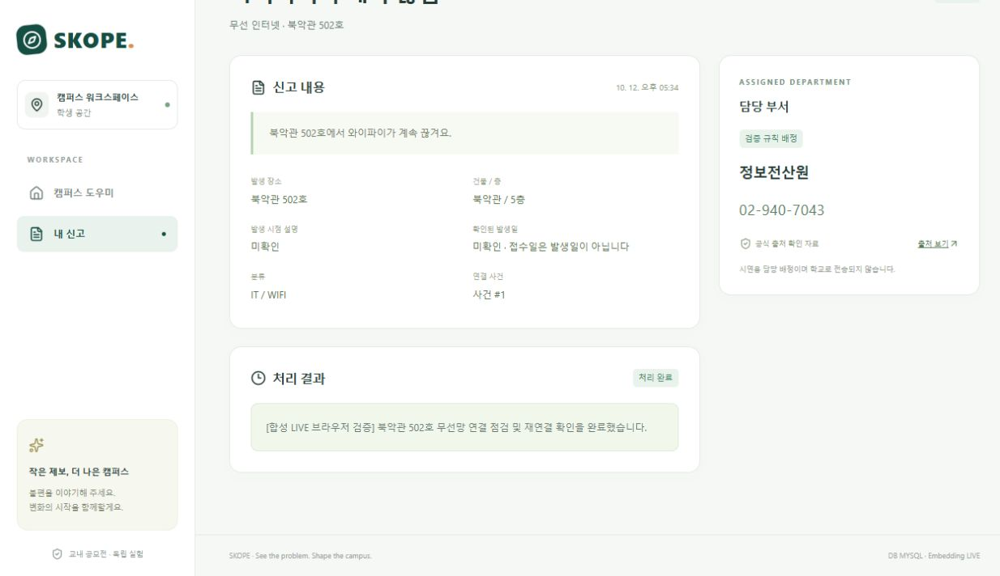

# 실제 AI·MySQL 브라우저 End-to-End 검증

최종 확인일: **2026-10-13 KST**. 실제 인앱 브라우저에서 학생 신고, 실제 AI 분석, MySQL 저장, 관리자 처리, 학생 결과 조회와 새로고침을 확인했다. **전체 흐름 PASS**. 합성 신고 1건을 사용했으며 학교로 전송하지 않았다.

## 실행 범위

- 브라우저: `http://127.0.0.1:5173`, API: loopback 8080, 실제 MySQL 8.0.45: loopback 3307.
- 전용 DB: **`skope_ai_quality`**. 기존 DEMO DB `skope`의 SK-000001과 별개다.
- 실행 모드: **AI LIVE / Embedding LIVE / MYSQL**. 화면의 `DEMO WORKSPACE`는 시연용 서비스 안내이며 AI 실행 모드는 별도의 `LIVE · 실제 AI` 표시로 확인했다.
- 모델: `gpt-6-luna`, `text-embedding-3-small`.
- 합성 입력: “북악관 502호에서 와이파이가 계속 끊겨요.”
- 전용 실행기 `scripts/Start-LiveVerificationBackend.ps1`은 로컬 키 파일을 환경 변수로 전달하고 검증 서버에만 LIVE를 적용한다. 일반 실행의 DEMO/RULE_ONLY 기본값은 유지했다.

10월 12일 실제 분석·접수·관리자 처리를 수행했고, 10월 13일 최종 코드로 빌드한 서버와 MySQL을 다시 시작하여 동일 신고의 학생 조회를 완료했다. **처음 분석·접수 때는 최종 층 정규화·조건부 유사도 보조 규칙 적용 전 빌드였다.** 최종 변경의 30문장·20쌍 검증은 [캐시 재생](evaluation/quality-v2-replay-results.json)과 백엔드 회귀로 별도 확인했다. 최종 빌드에서 전체 AI 추론을 다시 실행했다고 주장하지 않는다.

## 단계별 상태와 증거

| 단계 | 상태 | 관찰한 결과 |
|---|---|---|
| student1 로그인·문장 입력·분석 | **PASS · 실제 LIVE** | 10월 12일 UI에서 분석 요청. IT/WIFI, 북악관/5/502호, 증상 추출 및 정보전산원 배정 미리보기. [분석 화면](screenshots/live-analysis.png) |
| 학생 확인·접수 | **PASS** | SK-000001 발급. [접수 화면](screenshots/live-submitted.png) |
| MySQL 저장·실제 Embedding | **PASS · 실제 LIVE** | report 1 RECEIVED, `text-embedding-3-small`, 1,536차원 저장. [접수 직후 DB](evaluation/live-browser-db-created.json) |
| 로그아웃·admin 로그인·처리 시작 | **PASS** | 같은 신고에서 IN_PROGRESS 전이 및 사건 #1 연결 |
| 관리자 결과 저장·완료 | **PASS** | RESOLVED 전이, 아래 결과 문장 저장. 최종 DB에서 신고·사건 모두 RESOLVED, 감사 이력 4건. [DB 증거](evaluation/live-browser-db-resolved.json) |
| 서버·DB 재시작 후 student1 재로그인 | **PASS** | 10월 13일 최종 빌드에서 내 신고의 SK-000001 처리 완료 상태 유지 |
| 학생 상세 결과 조회·새로고침 | **PASS** | `/reports/1`에서 관리자 결과 문장 확인. 실제 페이지 reload 후 같은 문장 재확인. [화면 접근성 기록](evaluation/live-browser-student-final.txt), [결과 화면](screenshots/live-student-result-detail.png) |

저장·조회한 결과는 **“[합성 LIVE 브라우저 검증] 북악관 502호 무선망 연결 점검 및 재연결 확인을 완료했습니다.”**다. 이 문장은 테스트용 관리자 입력이며 실제 시설 점검이 수행됐다는 의미는 아니다.

## 호출 비용과 검증의 구분

- 이 브라우저 흐름의 신규 API 호출은 **LLM 1회 + Embedding 1회 = 2회**다. 최종 조회·새로고침은 AI를 호출하지 않았다.
- 품질 평가의 LLM 30회 + 고유 Embedding 21회와 합쳐 **이번 품질 개선 단계 총 53회**다. 초기 평가 70회와 별도 집계다.
- **10월 13일 마무리 작업의 신규 API 호출은 0회**다. 저장 응답·벡터·DB 데이터를 재사용했다. 실제 청구서 검증은 하지 않았다.
- 과거 DEMO 브라우저 흐름은 [전체 검증 기록](verification.md)에 남겼으며 이 LIVE 흐름의 근거로 대체하지 않았다.
- 진행 중 세션 만료로 로그인 화면이 나타나 재로그인했고, 스크린샷 전체 페이지 캡처 오류는 지원되는 화면 캡처로 복구했다. 기능 실패로 집계하지 않았으며 최종 조회·새로고침은 성공했다.

## 미검증 범위

독립 사람이 검수한 데이터의 품질, 새로운 실사용 문장 분포, 최종 정책의 여러 유사 신고를 통한 LIVE 브라우저 비교, 운영 HTTPS·Secure 쿠키, 실제 AI 부하·장시간 운영은 **미검증**이다. 이번 결과는 합성 신고 1건의 로컬 HTTP E2E 성공이다. 기존 HTTPS 환경 차단과 운영 정책 미결정은 [전체 검증 기록](verification.md)에 별도로 남겼다.

마무리 시 검증용 프런트·백엔드와 작업 폴더의 격리 MySQL을 종료했고 코드·DB·캐시·증거를 보존했다. [종료 확인](evaluation/quality-cleanup.json), [단계별 기계 판독 기록](evaluation/live-browser-e2e-results.json), [품질 수정 전후 비교](ai-quality-comparison.md).
