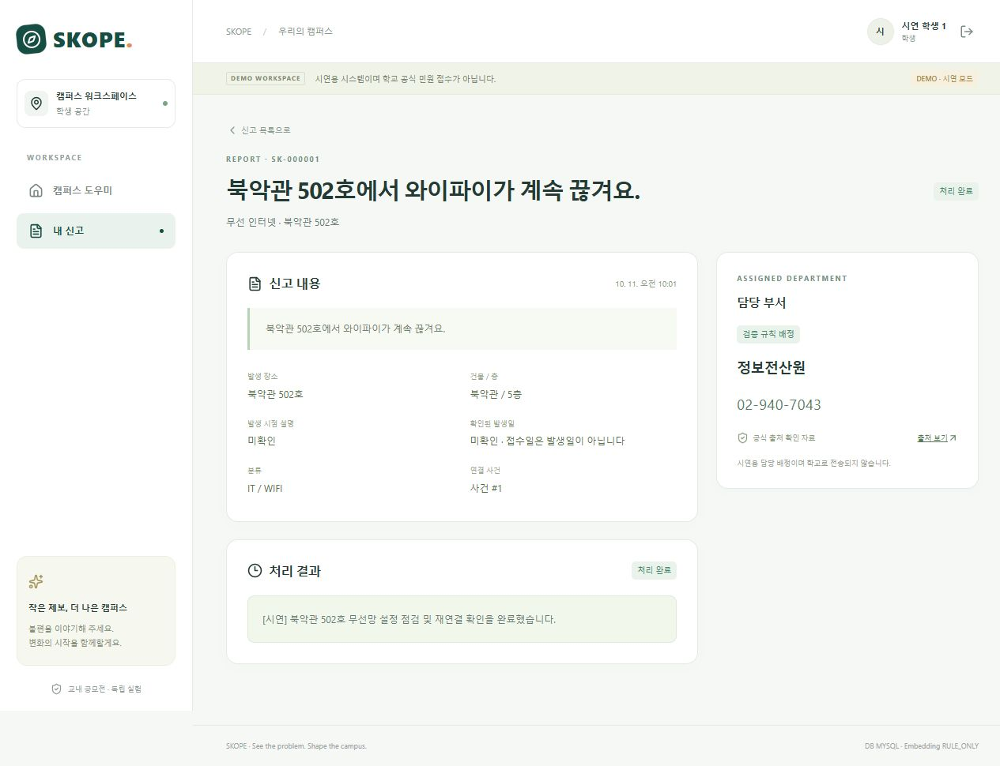

# SKOPE 구현·실행 검증 결과

최종 코드 검증일: **2026-10-27 KST**. 사용자가 제공한 명세와 이후 승인된 개선 요청을 기준으로 구현했다. 실제 학교 접수·Notion 수정은 수행하지 않았다. 외부 팀 공유와 과거 검증은 각 기록의 범위를 따른다.

## 2026-10-27 회원가입·프로필·비밀번호 API

- `feature/account-auth`, 시작 기준 main `8e46408`. 회원가입은 STUDENT만 생성하고 자동 로그인하지 않는다. 이름 수정, 현재 비밀번호 확인 후 변경, 인증 버전 기반 기존 세션 만료를 구현했다. 기존 로그인 응답에 `username`을 추가하고 계정 응답을 6개 공개 필드로 제한했다.
- V8은 `users.auth_version`만 추가한다. V1~V7은 변경하지 않는다. 새 버전 배포 시 기존 로그인 세션은 재로그인이 필요하지만 계정·접수·사진 데이터는 보존한다.
- 신규 HTTP 계정 테스트 **35 PASS**: 입력/UTF-8 경계·필드 오류·권한 주입 차단·CSRF·동시 중복 가입·자기 정보 수정·잘못된 현재 비밀번호·동시 비밀번호 변경·자신의 모든 세션 만료·타인 세션 유지·기존 접수 보존·계정 전환 시 서버 초안 제거·사용자 지정 쿠키 삭제.
- 전체 기본 회귀: **H2 417 PASS / 0 FAIL / 14 SKIP**, **MySQL 417 PASS / 0 FAIL / 14 SKIP** (각 431건). 신규 35건은 각 전체 집계에 포함한다. H2 메모리 DB와 전용 `skope_account_auth_20261027` DB를 사용했으며 기존 공유 DB는 변경하지 않았다. SKIP은 별도 opt-in 평가이며 성공으로 합산하지 않는다.
- 백엔드 `bootJar` 빌드 PASS. 실행 중 공유 서버의 파일 교체를 피하기 위해 별도 빌드 출력 폴더를 사용했다. 변경 파일의 알려진 로컬 비밀값·일반 키 패턴 검사에서 검출 0건이며 모든 유출 가능성의 보증은 아니다.
- 유료 AI 호출·토큰·비용 **0**. DEMO/RULE_ONLY 검증이며 LIVE 품질 검증을 뜻하지 않는다. 상세 실행 증거는 로컬의 Git 제외 경로 `.runtime/account-auth-tests/{h2,mysql}`에 보존한다.
- `/signup`, `/profile`의 공유 프록시 경로만 추가했으며 해당 화면은 프런트 담당 구현 대상이다. 이번 계정 변경의 브라우저 UI E2E·공유 서버 배포는 아직 수행하지 않았다. 프런트 연결 후 별도 확인한다.
- 외부 팀 암호는 유지한다. 제거는 동기 담당 LIVE 전체 비용 제한 통합 후 검토한다. 가입/로그인 요청 제한·학교 재학생 인증·분실 비밀번호 복구는 이번 범위가 아니다. API 계약은 [회원가입·내 정보 연동](api-contract.md#회원가입내-정보-연동)을 따른다.

## 2026-10-23 사진 PR 및 로컬 최신 변경 통합

사진 PR #1의 `41512b6`(첨부 V5·정리 장부 V6), 부서별 관리자·이관, AI `hybrid-intake-v2` / `hybrid-check-v3`, 공식 장소 예시와 과거 평가 자료를 통합했다. 기존 V1~V5는 그대로다. 프런트 디자인 교체 및 사진 화면은 담당자 후속 작업으로 남겼다.

| 검증 | 결과 | 범위 |
|---|---|---|
| 백엔드 전체 H2 회귀 | 347 PASS / 0 FAIL / 14 SKIP | 361건. 유료·캐시 평가 opt-in 14건 제외 |
| MySQL 포함 통합/첨부 회귀 | 92 PASS / 0 FAIL / 0 SKIP | MySQL 사용 59건 + 파일/이미지 단위 33건 |
| V4 → V5 → V6 | PASS | 기존 `skope_test`에서 Flyway 적용·기존 버전 체크섬 확인 |
| 자연어 접수 + 사진 + 부서 재배정 + 학생 결과 | PASS | 새 HTTP 통합 사례, 위 MySQL 집계에 포함 |
| 추가 HTTP 통합 사례의 H2 실행 | 1 PASS | 전체 회귀 후 추가한 위 사례만 실행. H2 합계 348 PASS / 14 SKIP |
| 프런트 회귀 / 빌드 | 57 PASS / 빌드 PASS | 기존 임시 UI, 디자인 변경 없음 |
| 백엔드 bootJar | PASS | 통합 제품 코드 |
| 비밀정보 검사 | 검출 0건 | 알려진 로컬 값·일반 키 패턴·금지 경로, 전체 보증 아님 |

유료 API 호출 0회. DEMO/RULE_ONLY 및 합성 사진을 사용했다. 이번 결과를 LIVE AI 정확도나 브라우저 사진 E2E로 보고하지 않는다. 기존 개발·시연 MySQL 데이터는 유지하고, 테스트 전용 DB만 백업 후 사용했다. 최초 샌드박스 실행은 Gradle 로컬 통신 제한으로 시작하지 못했으며 허용된 로컬 실행에서 위 검증을 완료했다.

삭제 실패 후 추적·재처리, 업로드 DB 저장 실패 시 파일 정리 추적, 정상 첨부 보존, 같은 인스턴스의 진행 중 업로드 보호, 재시작 상태 모의·배치 제한을 회귀 검증했다. 실제 프로세스 강제 종료는 이번에 재현하지 않았으며 팀원이 보고한 범위는 [첨부 운영 메모](report-attachments.md)에 구분되어 있다. 주기 정리 작업이 없다는 제한은 유지한다.

프런트 파일별 활용 방법과 API 연결 주의점은 [인수인계](TEAM_HANDOFF.md), 사진 API는 [계약](api-contract.md#사진-첨부-api-v5v6)을 참고한다.

## 2026-10-20 표현 변형 오류 수정

**이후 장소 예시 정정:** 공식 자료의 북악관 608호·은주2관 2층 205호·유담관 12층 1202호/14층 1404호를 확인하고 향후 평가 입력 및 임시 화면 데이터를 교체했다. 관련 로컬 166 PASS, 수동 시연 신고 저장·학생 조회 4/4 PASS. 현재 임시 화면은 DEMO/H2이며 신규 API 호출 0회다. 과거 LIVE 입력·응답과 MySQL은 보존했고 새 장소의 LIVE 품질은 미검증이다. [범위·출처·변경 파일](evaluation/campus-locations-review.md).

프롬프트 `hybrid-intake-v2`, 정책 `hybrid-check-v3`. 영어 혼합 표현의 불필요한 재질문과 축약된 더위 증상 누락을 수정했다. 관련 로컬 175 PASS 및 빌드 PASS, 기존 응답 12건 재생(옛 모델 누락 1건은 새 추론 필요), 새 LIVE 개발 사례 2/2·새 합성 사례 4/4 PASS. 최종 서버 HTTP 6/6 PASS는 실제 응답 캐시·격리 H2 기준이며 추가 API 0회다. 새 LIVE는 총 6회, 입력 10,148/출력 974토큰, 보수적 추정 $0.0017555. 수정 후 브라우저 클릭·MySQL·Embedding·관리자 처리 재검사는 미수행이다. [변경 파일·전후 비교·한계](evaluation/language-variation-v2-review.md).

## 2026-10-18 부서별 담당자·총괄 관리자·시연 배정

**구현·회귀·MySQL·브라우저 검증 완료. 새 유료 API 호출 0회.** 현재 등록된 정보전산원/전기실/건설관리과/교무과 4개 부서를 모두 지원한다. 학교 전체 조직을 새로 조사하거나 실제 학교 담당자 계정을 만든 것은 아니다. 기존 AI 모델·프롬프트·질문 정책과 학생 저장 요청 계약은 유지했다.

### 변경 범위

| 파일 | 변경 |
|---|---|
| `backend/src/main/resources/db/migration/V4__department_workflow.sql` | 사용자 소속 부서 FK, 시연 규칙 `demo_only`, 부서 조회 인덱스. V1~V3 원본 유지 |
| `DepartmentAccess.java`, `SecurityConfig.java`, `AuthController.java` | 총괄 ADMIN/부서 DEPT_ADMIN 구분, DB 소속·활성 상태 검증, 인증 응답에 부서 정보 |
| `ReportService.java`, `ApiController.java` | 부서별 목록·상세·처리 범위, 이관 사유/대기 목록, 총괄 재배정과 이력 |
| `IncidentService.java`, `SimilarityService.java` | 후보 양쪽·사건 전체 구성원 권한 검사, 타 부서 과거 사건 숨김, 부서 범위에서 후보 그룹 구성 |
| `RoutingService.java`, `SeedData.java`, `application.properties` | 시연 규칙 기본 비활성, 옵션 활성 시 부서별 계정 생성·누수 가정 배정, 미검증 연락처/출처 숨김 |
| `frontend/src/App.tsx`, `reports.tsx`, `student.tsx`, `ui.tsx`, `types.ts`, `styles.css` | 소속 부서 화면·이관 요청, 총괄 미배정/이관 필터·재배정 사유, 시연용 배정 표시 |
| `scripts/Start-Backend.ps1`, `Start-LiveVerificationBackend.ps1` | `-DemoRouting` 옵션. AI 모드와 배정 시연 설정을 분리 |

신규 테스트는 `DepartmentWorkflowTest.java`, `RoutingServiceTest.java`, `DepartmentWorkflowIntegrationTest.java`, `frontend/src/department-workflow.test.tsx`. 기존 `IncidentServiceTest.java`는 새 권한 검사 이후에도 DB 감사 이력 실패의 트랜잭션 롤백을 검사하도록 오류 주입 위치를 수정했다. `IncidentTestFixture.java`, `AiHoldoutTest.java`에는 V4 테스트 스키마를 반영했다. holdout LIVE 재실행은 하지 않았다.

### 결과

| 검사 | 결과 | 범위 |
|---|---|---|
| 백엔드 관련 6개 클래스 | **101 PASS / 0 FAIL / 0 SKIP** | 단위·H2 73 + 실제 HTTP/MySQL 28 |
| 부서 신규 HTTP/MySQL | **8 PASS** | 네 부서 처리, 타 부서 접근·CSRF 차단, 이관/재배정, 시연·미배정, 후보·사건·재발 제한, 기존 세션의 소속 변경/비활성 반영 |
| 기존 API HTTP/MySQL | **20 PASS** | 기존 접수·학생 소유권·관리자 처리 등 변경 영향 회귀 |
| 프런트 관련 | **52 PASS / 0 FAIL** | 부서 UI 9 + 기존 flows 35 + intake 6 + session privacy 2. 서로 다른 실행의 고유 테스트 합계이며 중복 합산하지 않음 |
| 빌드 | **bootJar / TypeScript / Vite PASS** | 새 라이브러리 없음 |
| 실제 브라우저 + MySQL | **PASS** | 아래 합성 신고 1건. AI는 DEMO, Embedding RULE_ONLY |
| 새 LIVE AI/Embedding | **미실행** | 호출·토큰·비용 모두 0. 기존 LIVE 정확도를 이번 버전의 새 측정으로 인용하지 않음 |

백엔드 클래스별: ApiIntegrationTest 20, DepartmentWorkflowIntegrationTest 8, DepartmentWorkflowTest 11, IncidentServiceTest 10, RoutingServiceTest 6, SimilarityServiceTest 46. HTTP 통합은 `skope_test`에서 실행했다. 초기 H2 실행에서 감사 이력 오류 주입 1건이 새 권한 검사에 먼저 차단되어 테스트 목적에 맞게 수정했고, 최종 실행은 모두 통과했다.

검토 중 타 부서 후보와 같은 전역 묶음에 들어가면 자기 부서의 후보까지 사라지는 경계 사례를 발견했다. 그룹 구성 전에 소속 부서 범위를 적용하고 신규 회귀를 추가했다. 서로 다른 부서의 신고를 포함한 사건 조회/처리와 부분 재배정은 차단한다.

### 브라우저 실행 증거

별도 `skope_department_verification` DB, 임시 백엔드 8081/프리뷰 4175, 고정 합성 입력 “북악관 502호 천장에서 물이 떨어져요.” 1건으로 검증했다. 개인 정보·LIVE 키는 사용하지 않았다.

1. student1이 입력 → DEMO 분석 → MySQL 신고 #1 → 건설관리과 시연용 가정 배정/미검증 안내 표시.
2. dept3이 소속 목록에서 확인 → 전기 안전 점검이 필요하다는 이관 사유 등록. 처리 상태와 현재 부서 유지.
3. admin이 이관 대기 필터에서 확인 → 사유를 남겨 전기실 재배정.
4. dept3 목록에서 제외되고 기존 상세 URL 직접 접근도 REPORT_NOT_FOUND. dept2는 새 배정 신고 확인 가능.
5. dept2가 처리 시작·완료 및 합성 조치 결과 등록 → student1 결과 조회·새로고침 후 유지.

증거: [부서 담당자 처리 완료](evidence/department-workflow-admin.png), [학생 결과 조회](evidence/department-workflow-student.png). 해당 테스트는 실제 UI·세션·CSRF·MySQL을 사용했지만 **실제 LLM 검증이 아니다**. 임시 검증 서버는 종료하고 데이터는 합성 검증 DB에 보존한다. 기존 사용자 시연 DB는 테스트 대상으로 사용하지 않았다.

### 남은 범위·협업

- 여러 신고가 이미 묶인 사건의 일괄 부서 이관, 담당자 개인별 할당, 외부 알림, 학교 실제 연동은 추가하지 않았다. 사건 일부를 나누는 재배정에는 명확한 409를 반환한다.
- 담당 부서 정보는 기존 기록 기준이며 시연 가정은 공식 경로로 승격하지 않았다. `DEMO_ROUTING_ENABLED=false`로 끄면 신규 시연 배정은 차단되지만 기존 기록은 삭제하지 않는다.
- 기본 신규 DB 계정은 admin(총괄), dept1~dept4(부서). 실제 ID/계정·시작 방법·이미지 개발자의 권한 계약은 [TEAM_HANDOFF.md](TEAM_HANDOFF.md) 참조.
- 이미지 팀원과 **V4 마이그레이션 번호 충돌 및 DEPT_ADMIN 이미지 접근 범위**를 합의해야 한다. 원격 브랜치 병합/푸시는 하지 않았다.


## 2026-10-16 발견 결함 수정 — hybrid-check-v2

**서버 수정·관련 검증 완료.** 아래 v1 오류 탐색 기록은 수정 전 기준으로 보존한다. 모델과 프롬프트(`hybrid-intake-v1`)는 유지하고 서버 정책만 `hybrid-check-v2`로 변경했다. UI, DB 스키마, 수동 신고 API 계약, 담당 부서 규칙, 유사도 임계값은 변경하지 않았다.

### 수정 내용·파일

| 파일 | 변경 내용 |
|---|---|
| `backend/src/main/java/edu/skope/ai/ClarificationPolicy.java` | WIFI의 충분성은 재서술된 AI 요약이 아닌 원문·추가 답변의 근거로 판단. 불확실한 비밀번호 언급과 문맥에서 잘린 범위 인용을 제외. 접속 실패 동의 표현, 명시된 전기 설비 대상과 실외 장소를 보완. 긴 원문의 뒤쪽 증상 근거와 장소만 보완할 때의 기존 설비 정보를 유지. 유용한 정보 정정은 최대 3회 범위에서 질문을 계속하고, 무진전 반복·모름은 관리자 검토로 종료 |
| `backend/src/main/java/edu/skope/ai/FollowUpPolicy.java` | 무효 층 값은 null로 정리. 농구장·축구장·테니스장·광장 등 실외 위치를 건물 없이 인정 |
| `backend/src/main/java/edu/skope/service/ReportService.java` | 서버 분석 전용 트랜잭션 진입점 `createFromAnalysis` 추가. 서버 소유 위험 플래그와 기존 규칙을 OR로 보존. 공개 수동 저장 JSON의 플래그는 신뢰하지 않음 |
| `backend/src/main/java/edu/skope/service/IntakeService.java` | 세션에 보관된 분석의 위험 경고를 내부 저장 진입점으로 전달 |
| `backend/src/main/java/edu/skope/ai/AiService.java` | 정책 버전만 v2로 올림. 프롬프트·모델 변경 없음 |

단어 몇 개만으로 모든 한국어 표현의 의미를 해결한 것은 아니다. 근거 검사와 기존 모델 제안을 함께 사용하며, 새로운 표현·복합 부정에서 추가 확인이 발생할 가능성은 남아 있다.

### 검증 결과

| 검증 | 결과 | 성격 |
|---|---|---|
| 관련 단위 회귀 | **107 PASS / 0 FAIL** | 기존 90 + 경계 회귀 17. 합성 모델/DEMO/Mock, LIVE 정확도 아님 |
| HTTP + MySQL | **25 PASS / 0 FAIL** | 기존 API 20 + 캐시/Stub 통합 5, `skope_test`만 사용. 학생 접수·관리자 처리·학생 조회·중복 방지·위험 경고 저장 확인 |
| 기존 LIVE 37단계 정책 재생 | **37 PASS / 0 FAIL / 3 미검증** | 수정 전 29 PASS / 8 FAIL / 3 미검증. 같은 고정 입력·정답 및 불변 공급자 응답 재사용 |
| 빌드 | **bootJar PASS** | 프런트 수정 없음. 기존 프런트 테스트를 반복하지 않음 |
| 새 유료 사용량 | **LLM 0 / Embedding 0 / 토큰 0 / 비용 $0** | 네트워크로 대체 호출하지 않는 재생 모드 |

원래 실패 8건은 모두 개선됐고, 평가 가능한 기존 정상 29건도 통과했다. 질문 여부의 동일 37단계 기준 TP/FP/TN/FN은 **11/5/18/3 → 14/0/23/0**, Precision **68.75% → 100%**, Recall **78.57% → 100%**다. **개발·수정에 사용한 동일 데이터의 서버 회귀 결과이며, 독립 AI 정확도 또는 유사 신고 지표로 발표하면 안 된다.** 정답은 변경하지 않았다. Codex 작성 라벨의 사람 독립 검수는 미완료다.

S26-2/3(건물 정정 후 상세 공간·장애 방식 보완), S28-2(시각은 모르지만 장애 방식 보완)는 기존 실제 응답이 없어 **LIVE 미검증**을 유지했다. 정정 후 질문 유지·횟수 제한 자체는 결정 로직에서 확인했다. 새 유료 호출은 필요 시 이 세 단계에 한정하면 된다. 재생은 원문+추가 답변으로 기존 출력을 선택하므로 v2로 달라진 이전 대화 상태에 대해 LLM이 실제로 같은 출력을 할지는 검증하지 않았다.

기존 저장 경계 실패 2건(모호한 WIFI 조기 접수, 모델 전용 위험 경고 소실)은 실제 MySQL 통합 재검증에서 통과했다. 위험 경고의 사례는 **합성 모델 출력 Stub**이며 해당 배터리 표현의 새 LIVE 탐지 성공을 의미하지 않는다. 이번에 새 브라우저 LIVE E2E는 실행하지 않았다.

실행 반영: 최종 bootJar 빌드 후 프로젝트 백엔드만 재시작(PID 13400). `/api/meta`에서 **LIVE / LIVE / MYSQL**, 프런트 5173에서 HTTP 200을 확인했다. 사용자 시연 DB `skope_ai_quality` 신고는 **4건 → 4건**으로 유지됐다. 서버 재시작으로 기존 로그인·세션 초안은 만료될 수 있으므로 화면 새로고침 후 다시 로그인한다.

### 검증 파일·재현

- `backend/src/test/java/edu/skope/ai/HybridBoundaryAuditTest.java`: 발견 반례를 상시 회귀 17개로 전환. 조기 접수, 층 정리, 실외 위치, 반복/횟수 제한, 수동 저장 플래그 불신뢰를 확인.
- `backend/src/test/java/edu/skope/service/IntakeServiceTest.java`: 서버 분석 전용 저장 호출을 검증하도록 조정.
- `backend/src/test/java/edu/skope/ai/HybridVerificationTest.java`, `scripts/Test-HybridVerification.ps1`: 네트워크 대체가 금지된 정책 재생 옵션을 추가. v1 결과/캐시를 덮어쓰지 않음.
- `backend/src/test/java/edu/skope/HybridReplayIntegrationTest.java`: 수정 후 증거를 별도 v2 결과에 기록.
- [수정 후 37단계 원시 출력·병합 결과](evaluation/hybrid-stress-v1-policy-v2-results.json), [HTTP/MySQL 실제 응답·132개 테스트 집계](evaluation/hybrid-replay-policy-v2-results.json).
- 재생: `scripts/Test-HybridVerification.ps1 -Mode OFFLINE -Suite hybrid-stress-v1 -ReplayPolicy`. 재생은 키를 사용하지 않으며 실행 완료와 개별 사례 PASS는 별도다.

## 2026-10-16 신규 스트레스 평가·오류 탐색

**검증 완료, 오류 발견. 제품 코드는 수정하지 않았다.** 앞선 9/9 결과는 좁은 개발 회귀 사례의 결과이며, 아래의 새 스트레스 평가에서는 질문 누락·불필요한 질문·저장 경계 오류가 드러났다. 결과를 보고 고정 기대값을 수정하지 않았다. 운영 서버를 재시작하지 않았고 사용자의 `skope_ai_quality` 데이터로 테스트하지 않았다.

### 범위·결과

| 구분 | 고유 검사 수 | PASS / FAIL / 미검증 | 설명 |
|---|---:|---|---|
| 새로운 LIVE 평가 | 30개 시나리오 / 40단계 | **29 / 8 / 3** | 37회 실제 호출. 잘못된 조기 접수로 이어갈 수 없는 후속 3단계는 호출하지 않음 |
| 결정 로직 경계 검사 | 11 | **0 / 11 / 0** | 취약점을 겨냥한 반례. 합성 모델 출력·Mock이며 일반 실패율/AI 정확도가 아님 |
| 실제 HTTP + MySQL | 5 | **3 / 2 / 0** | `skope_test` 격리 DB. 4개는 저장된 LIVE 응답 재생, 1개는 합성 위험 경고 Stub. 추가 유료 호출 0 |

LIVE에서 **추가 질문이 필요한가**를 기준으로 TP=11, FP=5, TN=18, FN=3. 질문 판단 Precision **68.75%**, Recall **78.57%**. 평가 가능한 37단계 기준이며 의존 단계·표적 반례가 포함된 스트레스 셋이다. **유사 신고 Precision/Recall이나 실제 학생 분포의 AI 정확도가 아니다.** 라벨은 Codex 작성, 사람의 독립 검수 미완료다.

모델 `gpt-6-luna`, 프롬프트 `hybrid-intake-v1`, 정책 `hybrid-check-v1`. 입력 **61,993**, 출력 **6,693**, 총 **68,686토큰**, LLM **37회**, Embedding **0회**, 자동 유료 재시도 **0회**. [공식 요율](https://developers.openai.com/api/docs/models/gpt-6-luna) 기준 예상 **$0.0095458**이며 캐시 할인 미반영/청구서 미확인이다. 사전 최대 40회·2배 여유 예약 **$0.40192**, 실행 예산 $0.45로 기존 목표 $1 이내. 이전 9회 검증 비용과 이번 비용은 별개로 기록한다.

### LIVE에서 발견한 8개 실패

| 사례 | 고정 기대 → 실제 | 원인 및 영향 |
|---|---|---|
| S01 “와이파이에 접속할 수 없어요” | 완료 → 추가 질문 | 모델은 구체적 장애로 추출했지만 서버 WIFI 표현 목록이 동의 표현을 인정하지 않음 |
| S03 “이름은 보이는데 선택하면 접속할 수 없다고 나와요” | 완료 → 추가 질문 | 같은 이유. 이미 제공한 장애 방식을 다시 물음 |
| S04 “안 돼요. 비밀번호 문제인지는 모르겠어요” | 추가 질문 → 완료 | 모델이 “연결되지 않음”으로 과도하게 구체화. assessment는 SYMPTOM_DETAIL인데 서버는 요약만 보고 충분하다고 판단 |
| S07 “멀티탭에 플러그를 꽂아도 고정되지 않고 빠져요” | 완료 → 대상 질문 | 모델의 정확한 대상 인용에도 `target` 목록에 멀티탭/플러그가 없어 재질문 |
| S08 “분전함 덮개가 닫히지 않아요” | 완료 → 대상 질문 | `target` 목록에 분전함이 없어 재질문 |
| S22 “교내 농구장 중앙 바닥이 깨져 발이 걸려요” | 완료 → 장소 질문 | 기존 `validPlace`가 건물 또는 제한된 실외 장소 목록에 의존해 농구장을 인정하지 않음 |
| S26-1 “한빛관 512호 와이파이가 안 돼요” | 추가 질문 → 완료 | 모델이 “연결이 안 됨”으로 바꿈. 모델의 SYMPTOM_DETAIL 제안과 서버 종료 판단 불일치. 실제 MySQL 접수에서도 질문 없이 저장됨 |
| S28-1 “다솜관 전체에서 와이파이가 안 돼요” | 추가 질문 → 완료 | 모델이 “연결되지 않음”으로 과도하게 구체화하고 NONE 제안. 서버도 원문 근거 없이 이를 충분한 장애 방식으로 인정 |

S26-2/3, S28-2는 첫 결과가 이미 COMPLETE여서 실제 intake에서 도달할 수 없는 후속 답변이다. 정답을 바꾸거나 존재하지 않는 대화를 이어서 성공으로 세지 않았다.

### 별도로 재현한 서버·저장 경계 문제

- **위험 경고 소실 — 제출 전 우선 수정 권장.** 모델만 인식한 위험을 `AiService`가 emergencyHint=true로 처리해도 `ReportService.create`는 원문+증상 키워드로 다시 계산한다. “배터리가 부풀어 올라 터질 것 같아요” 합성 모델 경고가 실제 HTTP → MySQL 저장 후 false로 내려갔다. 이는 해당 표현을 실제 LLM이 감지했다는 증거가 아니라 **모델이 감지했을 때 보존되지 않는 결함의 Stub+실DB 재현**이다. 임의 클라이언트 플래그를 신뢰하는 수정 대신 서버가 검증한 분석 결과의 전달 경로가 필요하다. 관련: `ReportService.java:26`.
- **유용한 부분 정정도 조기 종료.** 증상을 묻는 중 건물만 정정하면 `askedReasons`와 아직 필요한 사유가 겹쳐 즉시 MANUAL_REVIEW가 된다. 실제 정보 진전이 있어도 동일 사유를 아직 못 채웠다는 이유로 대화를 끝낸다. 결정 로직에서 재현했으며 S26 후속 LIVE는 조기 접수 때문에 미검증이다. 관련: `ClarificationPolicy.java:68`.
- **없는 정보를 있는 것으로 인정할 수 있음.** floor="미확인"처럼 비어 있지 않은 무효 값도 구체적 위치로 취급한다. `scopeEvidence="건물 전체"`가 “건물 전체가 아니라…”에서 잘린 인용이면 부정을 무시해 전체 범위로 인정한다. 두 항목은 합성 모델 출력으로 재현했고 실제 LIVE 발생 빈도는 미측정이다. 관련: `ClarificationPolicy.java:30`, `:44`, `:48`.
- **키워드만으로 장애 방식 인정.** “비밀번호 문제인지 모름”도 단어가 있다는 이유로 WIFI 상세 증상으로 인정할 수 있다. 정확한 원문 근거와 확정/부정/불확실 상태가 함께 필요하다. 관련: `ClarificationPolicy.java:92`.

### 정상 동작과 범위 제한

- 실제 LIVE에서 누수·의자 모호성·엘리베이터·수도·학사 문의·정정·지하 층·층/호실 충돌·긴급 긍정/부정·단일 프롬프트 공격 사례가 고정 기대를 충족했다. 한 공격 사례 통과는 보안 검증 완료를 의미하지 않는다.
- 캐시 LIVE 누수 응답으로 학생 접수 → 중복 요청 방지 → 관리자 처리 시작/완료 → 학생 결과 조회를 **실제 HTTP/MySQL에서 통과**했다. 3단계 WIFI 대화의 장소 보존/단일 저장도 통과했다. 새 유료 LIVE 호출과 DB를 묶은 브라우저 E2E는 아니다.
- 복합 신고 S18은 두 증상이 요약·DB에 보존됐고, 현재 LEAK 규칙이 비활성이어서 NEEDS_REVIEW로 접수됐다. 이 추가 저장 검사는 PASS다. 다만 구조는 한 신고/한 유형이므로 자동 분할·복수 부서 배정은 지원하지 않는다. 이것을 이번 실제 잘못된 배정 사례로 보고하지 않는다. 저장 검사의 기대는 S18 확인 후 별도 고정한 개발 검사이며 최초 LIVE 지표에는 추가하지 않았다.
- 제품 수정·배포·재시작·새 라이브러리 설치 없음. 테스트·평가 파일만 추가/수정했다. JUnit이 실패한 경계/통합 검사는 위 결함을 의도적으로 드러낸 것이며 정상으로 바꾸기 위해 정답을 낮추지 않았다. `SKOPE_RUN_BOUNDARY_AUDIT=1`에서만 실행된다.
- 최종 읽기 전용 실행 확인에서 `127.0.0.1:8080`과 MySQL `3307`은 연결 거부 상태였다. 위 저장 검증의 성공/실패 기록은 이미 완료된 테스트 실행 증거이며, 현재 서비스가 실행 중이라는 의미가 아니다. 이번 오류 탐색에서 기존 서버/MySQL을 종료하거나 재가동하지 않았다. 종료 시점의 시연 DB 건수는 재확인하지 못했다.

### 권장 수정 순서

1. 서버가 판단한 위험 경고를 저장·완료 화면까지 보존한다.
2. AI가 재서술한 `symptom`을 근거로 충분성을 확정하지 않는다. 원문/추가 답변의 실제 근거와 모델의 추가 확인 사유가 충돌하면 보수적으로 확인한다.
3. 대상·장소·장애 방식의 의미 판단을 보완한다. 단어 몇 개만 추가하면 다음 동의 표현에서 재발하므로 근거의 구체성·부정·불확실성을 검사해야 한다.
4. 실제 정보 진전이 있는 정정과 무의미한 반복을 구분하고, 기존 최대 횟수 내에서 다른 필요한 질문을 이어간다.
5. 무효 층 값·문맥에서 잘린 범위 근거를 거른다. 수정 후 이번 고정 LIVE 원시 응답을 우선 재생하고, 새로운 유료 호출은 프롬프트 변경 등 꼭 필요한 경우에만 한다.

위 1~4는 공모전 시연의 기본 경험·안전 안내에 영향을 준다. 전체 캠퍼스의 표현 분포/기관 담당자 독립 라벨, 복수 부서 배정, 운영 부하·rate limit은 다음 단계다. 먼저 발견 결함을 수정하는 편이 같은 버전의 유료 표본을 더 늘리는 것보다 효과적이다.

### 증거·재현

- [실행 전 고정 30개 시나리오·40단계](evaluation/hybrid-stress-v1.json), SHA-256 `393ec0142f150a78e5f2a28acd98425283b8720cf95527701cd8d4fe24184112`.
- [실제 원시 AI 출력·최종 결과·실패 원인·사용량](evaluation/hybrid-stress-v1-results.json). 원시 공급자 응답은 기존 `AiQualityCache`의 `.runtime/ai-quality-cache/hybrid-stress-v1`에 불변 보존.
- [11개 결정 로직 실패](evaluation/hybrid-boundary-v1-results.json), [5개 HTTP/MySQL 결과·UTF-8 실제 응답](evaluation/hybrid-replay-v1-results.json).
- 기존 `HybridVerificationTest.java`, `scripts/Test-HybridVerification.ps1`에 평가 셋 선택을 추가했다. 기본 기존 셋은 유지. 무료 재생: `scripts/Test-HybridVerification.ps1 -Mode OFFLINE -Suite hybrid-stress-v1`. 새 평가가 이전 `hybrid-v1` 결과/캐시를 덮어쓰지 않는다.
- 신규 테스트 소스: `backend/src/test/java/edu/skope/ai/HybridBoundaryAuditTest.java`, `backend/src/test/java/edu/skope/HybridReplayIntegrationTest.java`. 후자는 캐시 응답을 원문+최신 답변으로 선택해 통합 경로를 검증하며 실제 서비스의 네트워크 호출을 대체한 테스트 전용 구성이다.

## 2026-10-16 하이브리드 추가 질문 판단

**완료: AI가 사실·근거·추가 확인 사유를 제안하고 서버가 질문의 필요성·중복·종료를 결정한다.** 아래의 앞선 “조건부 추가 질문” 기록보다 이 절의 정책·검증 결과가 최신이다.

- 기존 `missingFields`의 빈칸 검사 외에 구체적 위치, 장애 방식, 점검 대상, 업무 단계, 정보 충돌을 구분한다. WiFi의 “안 돼요”와 연결 후 인터넷 불가/끊김을 구별한다. 누수·전기 설비·OTHER 고장·학사 문의에도 필요한 최소 조건을 적용한다.
- 한 답변으로 장소·시간·증상을 보완하고 기존 안전 병합을 유지한다. 시점·분류만 부족해서 질문하지 않는다. 이미 물은 사유가 해결되지 않거나 모른다는 답이면 같은 질문을 반복하지 않고 관리자 검토 선택으로 종료한다. 최대 3회/무진전 2회 제한도 유지한다.
- 충분한 내용은 바로 접수한다. 긴급 징후에 질문을 강제하지 않고 부족한 정보는 검토 메모로 남긴다. 접수 완료 화면에도 긴급 안전 안내를 유지한다. 학교·긴급 기관으로 실제 전송하는 기능은 아니다.
- 프런트는 질문 필요성 설명과 접수 완료 안전 안내만 추가했다. DB 마이그레이션, 수동 수정·저장 계약, 배정 규칙, 유사도 임계값은 변경하지 않았다. 기본 intake에만 hybrid를 적용하고 기존 분석 API는 옵션 생략 시 호환 동작한다.

### 결과와 재현

| 검증 | 결과 / 범위 |
|---|---|
| 결정 로직·AI 스키마·병합·접수 회귀 | **90 PASS**: AiService 22, AiFollowUp 5, FollowUpPolicy 41, ClarificationPolicy 18, IntakeService 4. DEMO/Stub이며 LIVE 정확도 아님 |
| 실제 MySQL HTTP API | **20 PASS**, 격리 `skope_test`; 기존 18개 + WiFi 위치/장애 방식 보완 후 단일 저장 + 긴급 불완전 입력 즉시 검토 접수. AI DEMO/RULE_ONLY |
| 프런트 | **48 PASS**, TypeScript/Vite 빌드 PASS. 질문 사유와 접수 후 긴급 안내 포함 |
| 실행 반영 | bootJar PASS. backend **PID 23328**, 기존 frontend PID 16732 유지. `/api/meta`: LIVE/LIVE/MYSQL, 5173 HTTP 200. 로그인/CSRF 후 만료 초안 resume 409 확인(추가 AI 호출 없음) |
| 기존 시연 데이터 보존 | `skope_ai_quality` 신고 **3건 → 3건**. 사용자 데이터에 신규 평가 신고를 만들지 않음 |
| LIVE AI | **9 PASS / 0 FAIL / 0 미검증**. WiFi 모호성·복합 답변, 누수, 모호한 강의실/모름, 학적 처리 대기, 전기 시설 모호성, 위험 징후, 의자 흔들림 |
| 유료 사용량 | LLM **9회**, Embedding **0회**, 자동 재시도 **0회**. 입력 **15,166**, 출력 **1,525**, 합계 **16,691토큰**. 표준 요율 예상 **$0.0022791** (캐시 할인 미반영, 실제 청구서 미확인) |
| 사전 예산 | 누적 최대 9회, 40,000 입력 토큰 보수 상한/2,048 출력 상한과 2배 여유로 **$0.090432** 예약, 이번 실행 한도 $0.10. 기존 사용자 목표 $1 이내 |

[고정 입력·기대 결과](evaluation/hybrid-v1.json), [실제 AI 원시 출력·병합 결과·사용량](evaluation/hybrid-v1-results.json), [재현 스크립트](../scripts/Test-HybridVerification.ps1). 기존 `AiQualityCache`를 재사용하며 원시 응답은 `.runtime/ai-quality-cache/hybrid-v1`에 보존한다. 기존 평가 파일/캐시는 변경하지 않았다. 스크립트 기본 OFFLINE이며 실패/중단된 유료 요청은 다시 호출하지 않는다. 시작 스크립트의 PowerShell 문자열 구문 오류는 **API 호출 전에** 수정했다.

모델 `gpt-6-luna`, 프롬프트 `hybrid-intake-v1`, 정책 `hybrid-check-v1`. [공식 모델 요율](https://developers.openai.com/api/docs/models/gpt-6-luna)을 2026-10-16 확인: 입력 $0.10/M, 출력 $0.50/M. 모든 입력은 합성 데이터이며 정답은 실행 전 SHA-256으로 고정했다. **Codex가 작성한 개발 회귀 사례로, 사람의 독립 검수·새로운 분포의 정확도나 Precision/Recall 측정이 아니다.** 의자 사례의 DEMO 추출 미지원은 실제 정책 검사와 분리했고 LIVE에서는 정상 추출/종료를 확인했다.

### 변경 파일

| 파일 | 변경 내용 |
|---|---|
| `backend/src/main/java/edu/skope/ai/ClarificationPolicy.java` (신규) | 유형별 최소 정보·근거 검사·사유별 질문·중복 방지·긴급 예외 |
| `backend/src/main/java/edu/skope/ai/AiService.java` | hybrid 프롬프트/엄격한 응답 스키마, 근거·사유 추출과 정책 연결 |
| `backend/src/main/java/edu/skope/ai/FollowUpPolicy.java` | 기존 안전 병합을 유지하며 질문 사유·확보 근거 상태 검증 |
| `backend/src/main/java/edu/skope/service/IntakeService.java` | hybrid 활성화, 검토 사유 저장, 긴급 불완전 신고 접수 |
| `frontend/src/types.ts`, `frontend/src/intake.tsx`, `frontend/src/student.tsx` | 추가 상태 타입, 질문 필요성 설명, 접수 완료 긴급 안내 |
| `backend/src/test/java/edu/skope/ai/ClarificationPolicyTest.java` (신규), `AiFollowUpTest.java`, `backend/src/test/java/edu/skope/service/IntakeServiceTest.java`, `backend/src/test/java/edu/skope/ApiIntegrationTest.java`, `frontend/src/intake.test.tsx` | 결정 로직·스키마·HTTP/MySQL·React 회귀 검사 |
| `backend/src/test/java/edu/skope/ai/HybridVerificationTest.java` (신규), `scripts/Test-HybridVerification.ps1` (신규) | 고정 LIVE 사례, 호출 상한, 재시도 금지, 기존 캐시 활용 |
| `docs/evaluation/hybrid-v1.json`, `docs/evaluation/hybrid-v1-results.json` (신규) | 실행 전 기대 결과와 실행 후 실제 출력·사용량 |
| `docs/api-contract.md`, `docs/verification.md` | 계약 및 이번 변경·검증 범위 기록 |

### 한계

- AI의 의미 오해·오추출과 서버 규칙에 없는 표현은 여전히 가능하다. AI의 질문 원문은 직접 표시하지 않고 검증된 사유에 대응하는 서버 문구를 사용한다. 근거가 원문에 있다는 것이 의미 판단의 정확성을 보장하지 않는다.
- 이번 LIVE는 운영 `AiService`의 실제 응답/후처리 검증이다. 최종 화면에서 **LIVE 호출과 MySQL 저장을 결합한 새로운 브라우저 E2E는 미검증**이며, 별도 실제 MySQL/DEMO HTTP 통합·React DOM 검사와 구분한다. 기존 브라우저 E2E를 이번 정책의 증거로 재사용하지 않는다.
- 유사도 정책·Embedding을 변경하지 않아 추가 유료 평가하지 않았다. 기존 Recall 한계는 그대로 남는다. 세션 초안 소실, 운영 rate limit, 실제 학교 연동 등은 기존 운영 과제다.

## 2026-10-16 조건부 추가 질문·바로 접수

**수정 완료: 충분한 입력은 상세 확인 양식 없이 접수, 부족한 입력만 추가 질문. 일반 문의도 관리자 답변 대상으로 접수한다.** 이전 날짜의 확인 화면 유지·문의 미접수·검토 사유 미저장 설명은 당시 기록이며 이번 변경이 우선한다.

### 변경 범위

- 새 `/assistant/intake`가 분석 → 필요 정보 판단 → 저장을 연결한다. 첫 버튼 `문의·신고 보내기`가 접수 의사를 나타낸다. 기본 경로에서 날짜·시간·장소·유형을 모두 확인하는 양식을 제거하고 수동 수정으로만 남겼다.
- 문제 내용이 모호하면 장소보다 실제 문제를 먼저 묻는다. AI의 구체성 추출과 서버 검사를 함께 사용한다. 문의·학적 요청에 장소를 요구하지 않으며 발생 시각은 선택 사항이다. 언급된 시점 표현과 자동 접수 시각을 구분한다.
- 서버 세션에 초안/질문 상태를 보관한다. 추가 답변 최대 3회, 연속 무진전 2회 종료. 충분성 판단과 질문 종료를 구분하며 한계·충돌·AI 실패 시 관리자 검토 접수를 선택할 수 있다. 서버가 보유한 상태로 안전 병합하고 같은 요청/오래된 답변 재전송으로 분석을 반복하지 않는다.
- V3 마이그레이션으로 `request_kind`, `review_note` 추가. 기존 행은 REPORT 유지. 미확정 정보와 필요 시 마지막 추가 답변을 검토 메모로 보존한다. 전체 대화 기록은 추가하지 않았다. 검토 접수는 NEEDS_REVIEW를 강제한다.
- 일반 문의는 관리자 답변 후 기존 처리 완료/학생 결과 조회를 사용한다. 문의를 Embedding·유사 후보·사건 연결에서 제외한다. 검토 메모가 있는 불확실한 신고도 자동 후보 생성에서 제외한다. 기존 유사도 임계값은 유지한다.
- 기존 수동 신고 API·분석 API와 안전 병합을 유지한다. 로그인·CSRF·학생 소유권·관리자 역할 검사도 유지한다.

### 검증 결과

| 항목 | 결과 / 구분 |
|---|---|
| 백엔드 변경 영향 회귀 | **144 PASS**, 실패·오류 0. AiService 22 / AiFollowUp 4 / FollowUpPolicy 41 / IntakeService 3 / API 18 / Incident 10 / Similarity 46 |
| 실제 MySQL HTTP 통합 | 위 API **18 PASS**는 `127.0.0.1:3307/skope_test`에서 실행. AI는 DEMO, Embedding은 RULE_ONLY. 별도 테스트 DB만 초기화 |
| 신규 HTTP 접수 흐름 6개 | 충분한 신고 자동 접수·날짜 선택·관리자 처리·학생 조회, 모호한 문제→증상→장소 보완·정보 유지, 문의 접수·답변·사건 제외, 무진전 종료·검토 사유 저장, 동시/중복 접수·만료, CSRF·역할·다른 학생 초안 보호 PASS |
| 실패/재시도 결정 로직 | 공급자 실패 후 자동 재시도 없음, 기존 정보·미분석 추가 답변 보존, 저장 후 Embedding 실패에도 접수 보존 PASS. **Mock/Stub이며 LIVE 품질이 아님** |
| 프런트엔드 | **46 PASS**, TypeScript/Vite 빌드 PASS. 신규 UI 4개는 React DOM 테스트: 바로 접수, 필요한 질문만, 네트워크 실패 시 답변 보존, AI 실패 검토 경로 |
| 서버 빌드 | bootJar PASS |
| 실행 환경 반영 | backend PID 15260 / frontend PID 16732. `/api/meta` LIVE / LIVE / MYSQL, 5173 HTTP 200, 새 intake의 만료 초안 재개 409 확인. 실제 분석 요청은 보내지 않음 |
| 기존 시연 데이터 | `skope_ai_quality` 접수 2건 → 2건 유지. V1~V3 성공. 변경 전 `.runtime/skope-ai-quality-before-intake-20261016.sql` 백업 |
| 새로운 유료 API 호출 / 토큰 / 비용 | **0회 / 0 / $0** |

프롬프트 `intake-v1`, 정책 `safe-merge-v3`. 테스트 입력·예상 결과는 신규 회귀 테스트 소스에 고정했다. 기존 LIVE 평가 파일/응답 캐시는 덮어쓰지 않았다. 이번 PASS는 코드·동작 검증이며 독립 AI 정확도/Precision/Recall을 새로 측정한 결과가 아니다.

### 남은 한계

- 수정 프롬프트의 **새로운 실제 LLM 호출 품질과 최종 LIVE 브라우저 전체 접수 흐름은 이번에 미검증**이다. LIVE 설정으로 실행 가능한 상태와 MySQL/DEMO 연동 검증을 구분한다. 기존 LIVE 품질 수치를 이번 변경의 정확도로 재사용하지 않는다.
- 새 접수 흐름은 학생이 모든 추출값을 확인하지 않으므로 LLM 오추출 가능성은 남는다. 원문·최종 구조화 정보·검토 메모를 관리자가 확인할 수 있다. 학교 담당자에게 실제 전송하는 연동은 없다.
- 세션 재시작/만료 시 미접수 초안은 서버에서 사라진다. 브라우저 원문·마지막 응답으로 수동 수정할 수 있고 이미 접수한 UUID는 DB에서 복구한다. 서버별 분산 초안/호출 예산·악용 방지 rate limit은 운영 과제다.

## 2026-10-15 자연어 추가 답변 개선·LIVE 검증

**자연어 답변 병합·후속 질문·부정문 긴급 판단을 수정했다. 최초 LIVE 15/16 → 서버 후처리 수정 후 같은 LIVE 원시 응답 재생 16/16 PASS. 실제 추가 호출은 LLM 16 + Embedding 3회, 재생은 0회다.** [고정 입력·기대 결과](evaluation/followup-v1.json), [수정 전후 결과·실제 모델 출력](evaluation/followup-v1-results.json), [실행 스크립트](../scripts/Test-FollowUpVerification.ps1).

### 변경 범위와 검증

- 기존 분석 API에서 최신 답변의 인용 근거와 `KEEP/SET/CLEAR/CLARIFY`를 받아 서버가 병합한다. 언급하지 않은 장소·시각·증상·유형은 보존하고, 명시적 정정은 해당 항목만 바꾼다. 한 답변의 여러 정보도 반영한다. 건물 변경 시 이전 층·호실 제거, 층/호실 충돌 시 재확인, 명시적 삭제와 부정된 삭제 구분, 지원 범위 밖 문제로 정정 시 OTHER/UNKNOWN 갱신을 검증했다.
- 장소·증상의 유효성과 미확정 여부로 질문한다. 발생 시각은 선택 사항이다. 추가 답변 최대 **3회**, 연속 정보 진전 없음 **2회**에서 종료한다. 이미 확보한 정보는 다시 묻지 않고, 수동으로 바꾼 항목의 검토 표시는 다음 재분석에서 해제한다. 횟수가 소진된 상태를 받으면 모델을 다시 호출하지 않는다.
- 위험 증상별 부정을 판별하며 긍정·부정·혼합·쉼표 목록·이중 부정·불확실 표현을 회귀 검증했다. 명시된 다른 위험 또는 모델 경고는 보수적으로 유지한다. 프런트 입력·수동 수정 경고도 같은 규칙을 반영했다.
- 프런트 변경은 추가 질문 상태 연결, 수동 수정/확인 날짜 보존, 종료 안내, 긴급 경고에 한정했다. 디자인·신규 라이브러리·DB·신고 저장 API·라우팅·유사도 임계값을 변경하지 않았다. 전체 대화 기록을 DB에 저장하지 않는다.

| 항목 | 최종 판정 | 범위 |
|---|---|---|
| 로컬 백엔드 | **119개 PASS** | 변경 영향별 실행한 서로 다른 검사: 기존 AiService 22, 추가 답변 통합 4, 병합 정책 35, 긴급 표현 56, 관련 HTTP/API 2. 마지막 후처리 변경 후 정책·통합 39개 재검증. Stub/DEMO/격리 H2이며 LIVE 품질 점수와 별개 |
| 프런트·빌드 | **35개 PASS**, 프런트 빌드·백엔드 bootJar **PASS** | 흐름 테스트 파일, TypeScript/Vite, 실행 JAR 생성. 기존 서버를 재시작하지 않음 |
| 최초 신고·문의, 복합 답변, 부분 정정·삭제 | **PASS** | 실제 LLM 결과에 운영 AiService/병합 정책 적용. 시각·증상만 정정할 때 다른 정보 보존 |
| 건물/층/호실·모호함·질문 종료 | **PASS** | N02 서버 오류 수정 후 저장 원시 응답 재생. 불충분한 답변 후 계속 질문, 충분하면 COMPLETE, 무진전 NO_PROGRESS, 최대 LIMIT |
| 긴급 긍정·부정·혼합 | **3/3 PASS** | LIVE 모델 경고 true/false/true 및 서버 판정. 이전 S13 문장은 결정적 로컬 회귀에 포함 |
| 유사 의미 2쌍 | **2/2 PASS** | 실제 벡터 + 운영 SimilarityService + 격리 H2. TP1/FP0/TN1/FN0, Precision 1/1·Recall 1/1. 자동 사건 연결 없음 |
| 최종 정책에서 원시 LIVE 응답/벡터 재생 | **16/16 PASS**, 추가 호출 **0회** | OFFLINE, 캐시 조회 20회. DEMO 대체 없음 |
| 수정 후 브라우저/MySQL E2E | **이번 작업 미검증** | 이전 검증 기록은 아래 보존. 이번에는 AI 병합·프런트 연결·관련 API 변경에 집중해 전체 흐름을 반복하지 않음 |

### 발견한 오류, 수정 전후와 남은 제한

N02: “건물이 해솔관이 아니라 다온관이에요. 층과 호실은 잘 모르겠어요.”에서 모델은 **다온관 / 층 null**을 맞게 반환했지만, 서버가 뒤 문장의 불확실성을 건물 정정에도 적용해 건물을 null로 지웠다. **LLM 오류가 아닌 서버 후처리 오류**다. 근거를 해당 항목으로 제한해 수정했고, 같은 캐시 키의 원시 응답을 재생하면 **다온관 / 층 null**을 유지한다. 수정 전 출력·실패 필드·원인은 결과 파일 `previousRunSummary.failedCases`에 보존했다. 층/호실만 충돌하는 경우에는 기존에 확인된 건물까지 지우지 않도록 추가 회귀도 보강했다.

최초 전체 단계 15/16, 개발에 이미 노출된 N02/N03/N10은 2/3이었다. 수정 후 전체 16/16, 개발 노출 3/3이며, 새 품질 시나리오는 전후 **9개 시나리오의 13단계 모두 통과**했다. 정답은 실행 전에 SHA-256 `bad04470eaf7ac57bbc791446dbed59ed69ff6179fbccf881cc8ee48d037d0a9`로 고정했고 바꾸지 않았다. **Codex 작성·개발자가 내용을 알고 있는 기대 결과이며 사람의 독립 검수가 아니다.** 단계끼리 같은 시나리오를 공유하고, 수정에 활용한 결과의 재생은 개발 회귀다. 16/16을 독립적인 일반 정확도로 제시하면 안 된다. 이 고정 기대 항목에서 추가 LLM 필드 오류는 발견하지 못했다.

유사도는 기본 **0.82**, WIFI 보조 기준 **0.70**을 유지했다. 새 양성 점수 0.847756은 통과하고, 같은 장소의 비밀번호 스티커 문제 0.725449는 연결 장애 보조 조건이 없어 제외됐다. 기존 10쌍 원점수는 새 API 없이 재사용했다. **P02 0.696457 < 0.70, P03 0.787971 < 0.82 누락은 미해결**이며 유형·장소·시간 필터는 통과한다. 임계값을 내리면 기존 음성 P07 0.794534, P10 0.804302까지 포함할 수 있다. 기존 Precision 100%·Recall 60%는 그대로이고, 새 2쌍만으로 전체 Recall 개선을 주장하지 않는다.

기존 계약 유지에 따른 제한: `reviewFields`는 초안에만 있고 신고에 저장되지 않는다. **초안 MANUAL_REVIEW는 저장 상태 NEEDS_REVIEW를 강제하지 않는다.** 학생이 기존 값을 최종 확인해 접수하면 기존 배정 규칙이 적용된다. 장소/건물 부족·미지원 유형은 기존 관리자 검토 경로로 접수할 수 있으나 증상은 기존처럼 필수다. 관리자에게 충돌 이력까지 전달하려면 별도 저장 계약 합의가 필요하므로 이번에 임의 확장하지 않았다. 클라이언트가 돌려주는 질문 횟수는 정상 UI의 대화 제한이며 악의적인 상태 초기화에 대한 서버 rate limit은 아니다. 모델이 잘못 해석한 내용을 완전히 보증하는 장치는 아니므로 최종 확인 화면은 유지한다.

### 비용·평가 데이터·팀 합의

- 실제 모델 **gpt-6-luna / text-embedding-3-small**. LLM **16회**: 입력 19,551 + 출력 2,058 = 21,609토큰. 고유 Embedding **3회**, 입력 249토큰. 합계 **19회 / 21,858토큰**. 호출 실패·자동 유료 재시도 **0회**. 최초 Embedding 재사용 1회, 이후 전체 OFFLINE 재생 추가 호출 0회.
- 사전 보수적 예상 상한 **$0.15404672**, 누적 제한 **$1**, 호출 상한 LLM20/Embedding4. 기록된 실제 usage와 표준 단가로 계산한 비용 **$0.00298908 (약 $0.003)**. 입력/출력 $0.10/$0.50 및 Embedding $0.02/백만 토큰을 사용했다. 공식 [LLM 단가](https://developers.openai.com/api/docs/models/gpt-6-luna), [Embedding 단가](https://developers.openai.com/api/docs/models/text-embedding-3-small)를 10월 14일 확인했으며 실제 청구서 금액은 확인하지 않았다.
- 기존 `docs/evaluation/` 및 `.runtime/ai-quality-cache/` 구조를 재사용했다. 입력·추가 답변·기대 결과·원시 출력·기존/최종 병합값·PASS/FAIL·원인·사용 모델·프롬프트 `followup-v1`·정책 `safe-merge-v1 → safe-merge-v2`·소스 해시·usage를 기록했다. 결과의 캐시 키로 각 호출 토큰을 연결한다. 원시 응답과 벡터는 `.runtime/ai-quality-cache/followup-v1`의 19개 SUCCESS 항목에 보존하며 API 키는 기록하지 않는다. 전부 합성 자료다.
- 디자이너/프런트와는 **복합 답변 허용 문구, 3회/2회 종료 안내, 미확정 필드 표시, 선택적 발생 시각, 최종 확인·수동 수정**을 합의하면 된다. 새 화면 설계나 PWA/배포 작업은 하지 않았다. API의 선택적 상태 필드와 한계는 [API 계약](api-contract.md)에 반영했다.
- 공모전 제출 전 이번 범위의 확인된 병합·긴급 회귀 결함은 수정했다. 시연/발표에서는 실제 LIVE와 Stub/DEMO, 독립 평가가 아닌 고정 사례, 남은 Recall 누락을 구분해야 한다. 수정본 전체 브라우저/MySQL 흐름은 이번에 반복하지 않았으므로 최종 UI 확정 후 짧은 시연 확인은 별도로 남는다. 충돌 이력 저장, 사람 독립 라벨 검수와 다양한 실제 표현 평가, 악용 방지 호출량 제한은 별도 정책·운영 준비 범위다. 추가 유료 검증은 종료한다.

## 2026-10-14 신규 데이터·최종 연동 추가 검증

**실제 AI 신규 평가와 HTTP/MySQL 연동 검증 완료. 문장 14/15, 유사 신고 Precision 100%·Recall 60%. 연동·예외 검사 16개 PASS. 제품 코드는 수정하지 않았다.** 상세 실제값과 사례별 판정은 [고정 입력·정답](evaluation/fresh-v1.json), [실행 결과](evaluation/fresh-v1-results.json)에 보존했다. 아래 10월 13일 이전의 개발셋 100%와 구분해야 한다.

실행 전에 기존 백엔드 93개 검증과 관련 코드를 확인했다. MySQL 중복·동시 접수, 관리자 결정 우회·자동 연결 방지의 기존 회귀는 반복하지 않았다. 부족했던 신규 표현 일반화, 최종 후처리·조건부 유사도 정책의 실제 MySQL 연동, 실제 접수 경로의 Embedding 실패 보존만 보강했다. 프런트 전체 테스트·브라우저 UI 재실행·디자인/PWA/배포 검토는 이번 범위에서 제외했다.

### 결과와 발견한 오류

| 신규 항목 | 판정 | 근거 |
|---|---|---|
| 실제 LLM 신규 문장 15개 | 14 PASS / 1 FAIL | 정상 신고·질문·모호함·긴급·유형 혼동 포함. 의도·유형·건물·층 모두 15/15, 긴급 표시 14/15 |
| 실제 Embedding 신규 10쌍 | 8 PASS / 2 FAIL | 양성 5·음성 5: TP 3 / FP 0 / TN 5 / FN 2. Precision 3/3=100%, Recall 3/5=60% |
| 실제 학생 분석→신고→MySQL→유사 후보→관리자 처리→학생 조회 | PASS | 정상 신고 2건. 최종 AI 층 값을 그대로 저장. 유형·장소·증상은 고정된 학생 확인값 사용. 두 신고 모두 RESOLVED·동일 처리 결과 조회 |
| 조건부 0.70 정책의 MySQL 적용 | PASS | P01 실제 코사인 0.801615로 기본 0.82 미달, WIFI 연결 장애 보조 기준으로 CANDIDATE 생성 |
| 자동 사건 연결·학생의 관리자 검토 우회 | PASS | 검토 전 incident=null, 학생 PATCH 403·결정 불변, 관리자 검토 후에만 SAME_INCIDENT |
| 저장 벡터 재사용·관리자 결정 보존 | PASS | 재색인 추가 API 0회, SAME_INCIDENT 및 검토자·시각 보존 |
| AI 공급자 429·응답 지연 | PASS | 로컬 HTTP 공급자 대역으로 실제 AiService 실행. API 503/AI_UNAVAILABLE, 신고 건수 불변, 각 공급자 요청 1회. 1초 timeout에서 2초 지연 응답을 1,056ms에 종료 |
| Embedding 503 실패 후 접수 보존 | PASS | 추가 합성 신고 1건 HTTP 201·MySQL 보존, 벡터 없음·incident=null. 후보는 점수 null/RULE_ONLY로 명시 |

| 오류 | 제외·오분류 원인과 영향 |
|---|---|
| S13 긴급 과잉 경고 | “불꽃이나 타는 냄새는 전혀 없습니다”인데 emergencyHint=true. `AiService.emergency()`가 부정 표현 없이 키워드만 찾고 분석 후처리가 OR로 강제한다. `ReportService.create()`도 같은 함수를 사용하므로 저장 시에도 영향을 주는 코드 경로다. S13 자체를 추가 접수하지는 않았다. 원시 모델 응답 전후를 따로 수집하지 않았으므로 LLM 자체 오분류로 단정하지 않는다. 긴급 상황 누락과는 구분한다. |
| P02 같은 WIFI 장애 누락 | 점수 **0.696457 < 0.70**. 양쪽 연결 장애 판별은 true이고 유형·건물·층·호실·시간 조건은 모두 통과. Embedding 기준에서만 제외됐다. |
| P03 같은 천장 배관 누수 누락 | 점수 **0.787971 < 0.82**. 유형·건물·층·호실·시간 조건은 모두 통과. 누수는 WIFI 전용 보조 기준 대상이 아니므로 Embedding 기준에서만 제외됐다. |

같은 신규 벡터의 진단값에서 기본 0.82만 적용하면 TP 2/FP 0/TN 5/FN 3, Precision 100%·Recall 40%다. 최종 조건부 정책은 이를 TP 3·Recall 60%로 개선했으나 누락 2쌍은 남았다. 이는 저장된 점수·진단값 비교이며 추가 모델 호출이나 정책 변경이 아니다. 기본 임계값을 누수 양성 0.787971까지 단순히 낮추면 음성 P07(안내판, 0.794534), P10(별개 배수구 문제, 0.804302)도 후보에 포함되므로 일괄 인하는 적절하지 않다.

### 호출·격리·증거 범위

- 실행 전 상한 **35회(LLM 15·Embedding 20)**, 고정 SHA-256 `3c2b8cd4b6294e5f52d81c6937214af8e755008ef0153a03ded6179bde3c76f2`. 실행 후 같은 해시 확인. 정답·임계값을 출력에 맞춰 바꾸지 않았다.
- 실제 호출 **28회 전부 성공: LLM 15 + 고유 Embedding 13**. Embedding 캐시 재사용 9회, 저장 DB 벡터 재색인 추가 호출 0회, 실패·자동 재시도 0회. 실제 모델은 `gpt-6-luna` / `text-embedding-3-small`.
- 공급자 usage: LLM 입력 **12,540**, 출력 **1,322**, 합계 **13,862토큰**. Embedding 입력 **1,112토큰**. 전체 **14,974토큰**. 청구 금액은 확인하지 않았으며 기존 단계의 호출 수와 별도다.
- 신규 MySQL 스키마 `skope_fresh_verification_20261014`에 **3건만** 저장: 정상 연동 2건 RESOLVED·1,536차원 벡터, 제어된 Embedding 실패 1건 RECEIVED·벡터 없음. 기존 개발·시연 DB는 사용하지 않았다. 유사 쌍 평가는 실제 벡터와 운영 SimilarityService를 격리 H2에서 실행했다.
- 정상 AI 결과는 LIVE이며 DEMO 대체 0건. 오류·지연은 실제 외부 공급자 장애가 아닌 **로컬 HTTP 대역 3회**다. 이번 연동은 실제 세션·CSRF·HTTP·MySQL 검증이고, 새 브라우저 조작 증거는 아니다.
- [검증 실행 스크립트](../scripts/Test-FreshVerification.ps1)로 대상 [테스트 클래스](../backend/src/test/java/edu/skope/ai/FreshVerificationTest.java)만 실행했다. 2026-10-14 03:25:24~03:26:21 KST 측정 완료, Gradle BUILD SUCCESSFUL. JUnit 측정 함수 1개 성공은 측정 실행 성공을 뜻하며 위 품질 FAIL 3사례를 없애지 않는다. 기존 DB가 비어 있지 않으면 재실행을 거절하며 자동 삭제·결과 덮어쓰기를 하지 않는다.
- 제품 소스 33개 해시 불변. 임시 검증 서버는 정상 종료했고 기존 3307·8080·5173 서버는 계속 실행 중임을 확인했다.

정답은 **Codex 작성이며 사람의 독립 검수가 아니다.** 기존 평가 입력과 동일 문장 중복은 0건이지만 주제는 겹치고 10쌍은 3개 기준 신고를 공유한다. 일부 층은 호실 번호의 규칙을 전제로 하며, 모호한 S10 의도와 지원 범위 밖 OTHER 분류는 프로젝트의 평가 정의다. 문장 점수는 후처리 필드 일치·증상/장소 존재 검사이고 질문 답변 전체의 근거·의미 정확도를 보장하지 않는다. 쌍의 유형·장소·증상은 고정 확인값이므로 10쌍 모두가 LLM 추출을 포함한 E2E라는 뜻도 아니다.

**공모전 영향:** 접수 차단·데이터 유실·권한 우회 등 시연을 막는 결함은 이번 범위에서 발견되지 않았다. S13 과잉 경고는 제출 전 우선 수정 권고 대상이고, 유사 신고 누락 2쌍과 Recall 60%는 발표·성능 설명에 반드시 반영해야 한다. 기존 개발셋 100%를 새 데이터의 일반 성능으로 제시하면 안 된다. 요청대로 오류는 수정하지 않았다.

**후속 판단:** 이번 범위의 추가 유료 검증은 종료한다. 향후 S13 또는 유사도 정책을 수정할 때 저장 결과·벡터와 해당 오류 사례만 무과금 회귀 검증하면 된다. 사람 검수·다양한 실제 표현에서의 품질 평가와 운영 수준의 장시간 장애 검증은 실제 서비스 준비 단계에서 진행할 항목이다.

## 이전 품질 개선 단계 판정(2026-10-13 보존 기록)

품질 개선 후 **백엔드 93개 성공·빌드 성공**, 저장된 실제 AI 결과의 오프라인 재생 성공, **학생 신고 → 실제 AI 분석 → MySQL 저장 → 관리자 처리 → 학생 결과 조회·새로고침** 브라우저 E2E 성공을 확인했다. 실제 분석 30회·고유 임베딩 21회 재측정과 브라우저 분석·임베딩 각 1회로 이번 품질 개선 단계의 추가 호출은 **53회**다. 10월 13일 마무리 검증의 추가 API 호출은 0회였다. [품질 비교](ai-quality-comparison.md), [LIVE 브라우저 E2E](live-browser-verification.md)

같은 30문장의 전체 필드 일치는 기존 LIVE 26/30 → 새 프롬프트의 실제 응답 29/30 → 저장 응답에 운영 층 정규화를 적용한 재생 30/30이다. 기존 오류 4건은 실제 재측정에서 모두 해결됐고, 새로 생긴 `1층`/`1` 형식 차이 1건을 후처리로 수정했다. 유사 후보는 저장된 실제 벡터로 TP 2→9 / FP 0 유지 / FN 7→0, Precision 100% / Recall 22.2%→100%를 확인했다. 기본 0.82는 유지하고 양쪽이 명시적 WIFI 연결 장애인 경우에만 0.70 보조 기준을 적용했다. 라벨을 보며 수정한 작은 개발셋 결과이며, 독립 운영 품질이 검증됐다는 뜻은 아니다. 초기 실패 결과도 [원래 LIVE 기록](live-ai-verification.md)에 보존했다.

| P0 범위 | 상태 | 확인 근거 및 한계 |
|---|---|---|
| 로그인·역할·학생 소유권·CSRF·로그아웃 | 실제 기능 완료 | 실제 HTTP 통합 테스트. 비활성화/역할 회수 시 기존 세션 무효화 포함 |
| 자연어 신고 의도·유형·장소 추출 | 실제 연동·개발셋 품질 개선 검증 | gpt-6-luna 재측정 29/30, 저장 응답의 층 정규화 후 30/30. 새 추론과 오프라인 후처리 구분 |
| 분석 결과 수정·수동 입력·신고 확정 | 실제 기능 완료 | React 컴포넌트 테스트 및 브라우저 접수 → MySQL 저장 |
| DB 규칙 담당 부서 배정·미매칭 검토 | 실제 기능 완료 | 활성·출처·검증일이 있는 규칙만 사용. 누수 정확한 담당 근거 미확보 → 관리자 확인 |
| 접수번호·본인 목록/상세·처리 결과 | 실제 기능 완료 | 브라우저 새로고침·계정 전환·서버 재시작 및 MySQL 조회 |
| 관리자 목록·재배정·상태·결과·감사 이력 | 실제 기능 완료 | 실제 HTTP 통합 테스트 및 관리자 브라우저 처리. 결과 없는 완료·잘못된 전이 거절 |
| 일반 질문·신고 전환·추가 질문 | 실제 기능 완료 | DEMO UI 흐름 및 LIVE 의도 추출 평가 확인. 최종 LIVE 브라우저에서 모든 질문 흐름을 반복하지는 않음. 검증된 DB 문의처만 답변, 질문/분석만으로 저장하지 않음 |
| Embedding 생성·점수 기반 유사 후보 | 실제 연동·개발셋 보정 검증 | 고유 벡터 21개 보존. 동일 벡터의 H2 재생에서 정답 9/9·오탐 0/11. 독립 검증 필요 |
| 규칙 기반 유사 후보·관리자 검토 | 실제 기능 완료 | RULE_ONLY 및 점수 null. 유형·장소·기간 필터와 20개 합성 쌍 테스트 |
| 동일 사건 묶음·종료·충돌 방지 | 실제 기능 완료 | 실제 MySQL HTTP로 신고 3건/사건 1건. 사건 종료·별도 결정 우회 방지·동시성 H2 회귀 |
| 완료 후 재발 후보·확인/반려 | 실제 기능 완료 | 종료 사건 참조·새 사건 분리·검토자/시각/이력 저장. 발생일 미확인 불확실성 유지 |
| 긴급 안내·분석 오류·빈 화면 | 실제 기능 완료 | 서버/컴포넌트 테스트. 안내만 제공하며 긴급 신고나 실제 출동 기능은 없음 |

확정 P0 업무 기능과 실제 AI 연결은 구현했다. 이번 요청의 오류 분석·같은 데이터 비교·품질 수정·LIVE 브라우저 E2E를 완료했다. 사람의 독립 검수와 다른 데이터에서의 일반화·운영 품질 검증은 남았다. 명세에서 제외한 RAG, 벡터 DB, Fine-tuning, 사진, 알림, 통계, 학교 시스템 연동은 구현하지 않았다.

## 환경·DB

- Windows, PowerShell 7, Temurin Java **25.0.4.1**, Spring Boot **4.1.1**, Gradle **9.7.1**.
- Node **24.20.0**, npm **11.19.0**, React 19 / TypeScript / Vite. 확정 설치 버전은 `frontend/package-lock.json` 및 [프런트 기록](frontend-verification.md).
- 실제 MySQL Community **8.0.45**, `127.0.0.1:3307`, 작업 폴더 `.runtime/mysql`의 별도 인스턴스.
- `skope`: 브라우저 시연 DB. `skope_test`: 자동 HTTP 통합 테스트 전용 DB. `skope_verification`: 이번 프록시·부하 검증 전용 DB(합성 203건).
- `skope_ai_quality`: 실제 AI 브라우저 E2E 전용 DB. 합성 신고 1건 `RESOLVED`, 사건 1건 `RESOLVED`, 감사 이력 4건, 실제 Embedding 1,536차원을 보존했다.
- 기존 두 DB와 새 검증 DB에서 Flyway **V1 core**, **V2 incidents** 적용 성공. V1 핵심 6개 테이블 + V2 사건 확장.
- 2026-10-11 10:08 KST 최종 서버 재시작에서 MySQL 연결 및 두 마이그레이션 checksum 검증 성공.

H2 실행은 별도 대체 경로다. MySQL 통합 실행 중에도 사건/유사성 단위 테스트는 자체 H2 fixture를 쓴다. 이 둘을 MySQL 단위 테스트로 세지 않았다.

## 자동 테스트·빌드 증거

**최신 2026-10-13 01:01 KST:** `Test-Backend.ps1 -MySQL`의 `clean test bootJar` 성공. **93개 PASS, 실패·오류 0**, opt-in 측정 3개 SKIPPED. 구성은 API/MySQL 12, AI 계약 22, DEMO 회귀 1, 캐시 3, 사건 10, 유사 후보 45다. [보존 집계](evaluation/quality-final-regression-summary.json). 이어 `Test-AiQualityReplay.ps1` 성공: 추가 API 0회, 문장 후처리 30/30, 실제 저장 벡터 20쌍 모두 기대값 일치, 원본·캐시 해시 불변. [재생 결과](evaluation/quality-v2-replay-results.json)

프런트 코드는 이번 품질 수정에서 변경하지 않았다. 아래 프런트 12개·빌드 증거는 10월 11일 실행 기록이며, 최종 백엔드를 연결한 실제 학생 조회 화면은 10월 13일 다시 검증했다. 아래 65개 집계는 이전 회귀 실행의 보존 기록이다.

아래 과거 실행에도 사용한 백엔드 명령:

```powershell
$env:JAVA_TOOL_OPTIONS='-Djavax.net.ssl.trustStoreType=Windows-ROOT -Djavax.net.ssl.trustStore=NONE'
.\scripts\Test-Backend.ps1 -MySQL
# 내부: backend/gradlew.bat clean test bootJar
```

2026-10-11 **14:04:27 KST**, `BUILD SUCCESSFUL`, **65개 성공 / 실패 0 / 오류 0**, 별도 opt-in holdout 측정 1개 SKIPPED. 최종 보안·사건 회귀 및 AI 출력 예산/usage 수집 테스트를 포함한다. [클래스별 보존 집계](evaluation/extended-regression-summary.json)

| 테스트 클래스 | PASS | 실행 방식 |
|---|---:|---|
| `ApiIntegrationTest` | 12 | 실제 임의 포트 HTTP 서버·쿠키/CSRF·MySQL `skope_test` |
| `AiServiceTest` | 17 | DEMO 및 로컬 HTTP 공급자 스텁, 출력 예산/usage 계약 |
| `AiEvaluationTest` | 1 | 30개 합성 문장 기대값 대조 |
| `IncidentServiceTest` | 10 | 격리 H2 fixture, 트랜잭션·동시성·결정 충돌 |
| `SimilarityServiceTest` | 25 | 격리 H2 fixture, 20개 합성 쌍 + 벡터/실패 테스트 |

초기 전체 H2 검증은 03:18 KST 당시 **62개 성공**, 이전 MySQL 회귀는 10:07:59 KST **64개 성공**이었다. 이후 AI 출력 예산/usage 테스트를 추가해 65개가 됐다. 최초 실행 기록을 소급 변경하지 않았다.

프런트 최종 명령은 `frontend`에서 `npm.cmd test`, `npm.cmd run build`. **14:15:44 KST 12/12 PASS**, TypeScript 검사와 Vite 프로덕션 빌드 성공. 세션 만료 뒤 남은 초안이 다음 사용자에게 노출될 수 있는 문제를 수정하고 회귀 2개를 추가했다. API를 Mock한 컴포넌트 테스트라는 한계는 [별도 기록](frontend-verification.md)에 명시했다.

출력 위치:

- `backend/build/libs/skope-0.1.0.jar`, `frontend/dist/`.
- `backend/build/test-results/test/TEST-*.xml`, `backend/build/reports/tests/test/index.html`.
- `.runtime/test-mysql-final.log` (로컬 로그, 공개 대상 아님).
- [보존한 30개 평가 입력·기대·실제·결과](evaluation/demo-results.md), [기계 판독 결과](evaluation/demo-results.json).
- [새 고정셋 결과](holdout-verification.md), [프록시·동시 요청 결과](deployment-verification.md). 이후 단독 holdout 실행이 Gradle의 기본 XML 보고서를 덮어쓰므로 65개 집계는 별도 JSON과 `.runtime/test-extended-regression.log`에 보존했다.

## 브라우저 → API → MySQL → 브라우저

**최신 LIVE 검증:** 10월 12일 학생 UI의 실제 분석·접수와 관리자 처리, 10월 13일 최종 빌드·MySQL 재시작 후 학생 재로그인·조회·새로고침을 완료했다. 전용 DB `skope_ai_quality`의 SK-000001이며 아래 과거 DEMO DB의 같은 번호와 별개다. [단계별 성공 및 증거](live-browser-verification.md)

아래는 **10월 11일 과거 DEMO 실행의 보존 기록**이다. 실제 인앱 브라우저 `http://127.0.0.1:5173`에서 다음 순서로 직접 조작했다. 학교로 전송하지 않는 합성 시연 데이터다.

1. student1 로그인, “북악관 502호에서 와이파이가 계속 끊겨요.” 입력·분석.
2. DEMO 추출 `REPORT/IT/WIFI`, 북악관/5층/502호, DB 규칙 정보전산원 배정 확인 후 확정.
3. **SK-000001** 접수. MySQL `reports.id=1`, `route_status=MATCHED`.
4. 로그아웃 후 admin 로그인. 동일 신고를 열어 **처리 시작 → 결과 입력 → 처리 완료**.
5. student1 재로그인, 내 신고 상세에서 **처리 완료** 및 “[시연] 북악관 502호 무선망 설정 점검 및 재연결 확인을 완료했습니다.” 확인.
6. 페이지 새로고침 후 같은 접수번호·결과 유지 확인.
7. 직접 MySQL 조회: 신고 1건 `RESOLVED`, 사건 1번 `RESOLVED`, 감사 이력 **4건**(`CREATED`, `INCIDENT_LINK`, `STATUS_CHANGED` 2회). 사건 종료 시각 `2026-10-11 10:05:14`.
8. 최종 백엔드 재시작 후 학생 로그인·조회에서 기존 접수번호·처리 완료 상태 유지 확인.
9. 일반 질문 “와이파이 문제 어디 문의해?”는 정보전산원 문의처와 공식 출처를 표시했다. “학교 인터넷이 안 돼요” → 추가 답변 “북악관 502호”는 건물·층·장소와 배정 미리보기를 갱신했다. 확정하지 않았으므로 내 신고는 여전히 **1건**이었다.
10. 기본 좁은 화면과 390×844 모바일, 1280×900 데스크톱에서 목록/상세를 확인했다. 모바일 목록은 가로 스크롤 표이며 제목·접수번호가 보였다. 모든 기기·브라우저 조합을 시험한 것은 아니다.



[모바일 상세 화면](screenshots/student-resolved.jpg)도 보존했다.

## 수정한 주요 오류와 설계 차이

- 초기 H2에서 MySQL 다중 `ALTER`가 실패하여 V2를 동등한 개별 ALTER/CREATE INDEX로 분리했다.
- JDBC 생성키가 ID와 시각 여러 열을 반환하던 차이를 ID 열 명시로 해결했다.
- 로그인 후 DB 계정 비활성화/역할 회수가 기존 세션에 반영되도록 전역 세션 재검증을 추가했다.
- 기존 `RELATED_DISTINCT`/`REJECTED` 결정을 수동·간접 사건 연결로 우회하는 문제를 차단했다.
- 프런트 JSX 오류, 세션 만료 뒤 오래된 CSRF 토큰, 누수 수동 선택 누락, 후보 모드 표시를 수정하고 다시 빌드·테스트했다.
- 초기 DEMO 30문장 중 4개 실패를 규칙 보완했다. 같은 셋 재실행 30/30은 독립 AI 정확도가 아니다.
- Windows에서 실행 중인 JAR가 최종 `clean`을 막았던 실행 순서 문제는 해당 로컬 서버를 중지하여 해결했다. 재실행 64개/빌드 성공, 이후 README의 `Start-Backend.ps1`로 시작했다.
- MySQL 사용자 지정 포트를 초기화·실행·테스트가 공유하도록 수정했다. 기본 3307 실제 실행은 검증했고, 비기본 포트는 구문 검증만 했다.
- 명세대로 V1/V2를 분리했으나 최종 새 설치 시 두 마이그레이션을 연속 적용한다. 최초 6개 테이블만 유지한 별도 브라우저 실행 단계는 재현하지 않았다.
- 발생일은 DATE 정밀도이므로 과거 종료일과 같은 날의 발생은 선후를 입증할 수 없어 재발 확정을 보수적으로 거절한다.
- Embedding은 저장 커밋 이후 사후 처리로 분리했다. 비동기 작업 큐는 없으며 외부 응답 timeout만큼 접수 응답이 지연될 수 있다.

## 재현·보안·남은 작업

[README](../README.md)에 최초 설치, MySQL/H2 준비, 실행·종료, 계정 생성, 인증서 환경, 실제 AI 환경 변수 및 테스트 명령을 기록했다. 로컬 계정 비밀번호는 `.runtime/demo-accounts.txt`에 생성되며 소스/SQL에 넣지 않았다.

10월 13일 정리 당시 검증용 프런트·백엔드와 작업 폴더의 격리 MySQL을 종료했고 코드·빌드 산출물·DB 데이터·검증 화면을 보존했다. 10월 14일 추가 검증에서는 이미 실행 중인 3307·8080·5173 서버를 유지했으며, 종료 시점에도 연결 가능함을 확인했다. 이후 다시 실행해야 한다면 루트에서 `Initialize-Local.ps1`, `Start-Backend.ps1`을 실행하고 별도 터미널의 `frontend`에서 `npm.cmd run dev -- --host 127.0.0.1`을 실행한다.

공개하지 않을 항목은 `.runtime/`, `.env`(예시 제외), DB 데이터, 비밀번호, `AI_API_KEY`, 로그/덤프다. BCrypt·CSRF·세션 권한·소유권은 시험했지만 운영 배포 보안 심사나 침투 테스트를 대신하지 않는다. 서버는 loopback에 바인딩한다. 실제 학교/Notion/외부 저장소 연동과 외부 배포는 없다.

## 남은 항목의 이번 실행 결과

| 항목 | 이번 진행 | 현재 판정 |
|---|---|---|
| 실제 AI 모델·키·비용 | 초기 70회 이후 품질 비교 51회+브라우저 2회 성공. 후속 재생은 0회 | 실제 연동·캐시 재사용 확인. usage 보존, 청구서 미확인. [품질 비교](ai-quality-comparison.md) |
| 개발셋 품질 개선·신규 평가 | 기존 개발셋 TP9/FP0. 10월 14일 신규 문장 14/15, 유사 쌍 TP3/FP0/FN2. 10월 15일 후속 답변 LIVE 15/16→후처리 수정·원시 응답 재생 16/16 | 기존 유사 평가 Precision 100%·Recall 60%, 누락 2쌍 유지. 긴급 부정 오탐 수정·새 LIVE 긍정/부정/혼합 통과. 인간 독립 검수 미완료. [후속 결과](evaluation/followup-v1-results.json), [이전 결과](evaluation/fresh-v1-results.json) |
| LIVE 브라우저·MySQL E2E | 학생 분석·접수 → 관리자 시작·완료 → 학생 조회·새로고침, 재시작 후 유지 | 성공. 합성 신고 1건의 로컬 HTTP 경로이며 운영 HTTPS·부하 검증은 아님. [증거](live-browser-verification.md) |
| 공식 누수·행정 근거 | 시설 사무분장, 저수조 단수 문의처, 대상별 2026 휴복학 공지 본문 확인 | 누수 전담 전화 미확인. 학기 신청기간 종료·대상별 절차 차이. LEAK 비활성과 앱 문의처 답변 범위 유지. [근거](source-reverification.md) |
| API 계약 | 현 구현의 엔드포인트·권한·요청/응답·오류 문서화 | 팀 최종 승인 아님. [계약](api-contract.md) |
| 접근·개인정보 | 저장/전송 목록·보관 공백 검토. 세션 만료/새 로그인 초안 삭제 수정 및 프런트 12/12 | 운영 보존기간·관리자 범위·rate limit·백업/복구 정책 미결정. [검토](privacy-security-review.md) |
| reverse proxy·동시성 | Vite 없이 빌드 번들/API 제공. 12항목 PASS, 4/12/24 동시 세션 총 400요청 실패 0, 별도 장애/경계 3항목 PASS | 2계정·짧은 로컬 HTTP·DEMO 실험. 실제 AI/장시간/운영 용량 검증 아님. [측정](deployment-verification.md) |
| HTTPS | 로컬 인증서 파일 자체 검증 OK. 실제 연결에서 Avast Untrusted Root 인증서로 교체됨을 확인 | 환경 차단. TLS 검증/백신을 끄지 않음. 정식 도메인·인증서·브라우저 Secure 쿠키 미검증 |

10월 14일 별도 합성 데이터의 품질 검증과 HTTP/MySQL 연동 검증을 추가 완료했고, 10월 15일 자연어 추가 답변과 긴급 부정 판단의 제품 코드를 수정·검증했다. 날짜별 증거 범위는 상단 기록을 따른다. 사람의 독립 라벨 검수와 실제 분포의 운영 품질 검증, 누수 전담 공식 근거, 팀의 API·보관·접근 결정, 신뢰 가능한 운영 TLS 환경은 여전히 남아 있다. 유사 후보 누락 2쌍은 미해결이다. 키 값은 채팅으로 받지 않으며 `.runtime/ai-verification.env`에서만 읽는다.

## 2026-10-27 접수에 필요한 추가 질문 간소화

- 기준: 처리 시작에 필요한 문제·대상·위치를 우선 확인한다. 명시된 설비의 고장을 다시 일반적인 불편 질문으로 되묻지 않는다. 원문에 근거한 명백한 파손·고장만 누락 보정하며 부정·추측·대상 불명확 표현은 보정하지 않는다.
- 위치를 유효하게 보완해 접수할 수 있으면 추가적인 장애 방식 질문은 생략한다. 문제 자체가 불명확하거나 대상·위치가 미확정이거나 정보가 충돌하면 질문을 유지한다. 최대 3회·반복 방지·긴급 접수·발생 시각 선택 정책은 유지한다. 유형만 불확실하면 관리자 검토로 전달한다.
- 화면: 실제 질문을 입력칸 위에 고정 표시하고, 누적 장소·문제·발생 시점과 원문 펼쳐보기를 제공한다. `이 내용으로 접수하기`는 입력 중인 답변도 미분석 자료로 보존한다. 직접 수정과 사진 첨부 API는 유지한다.
- 로컬 검증: 백엔드 147건(정책·병합·오류·접수 서비스 139건 + HTTP/H2 접수·관리자 처리·학생 조회 등 8건), 프론트엔드 84건 PASS. 이 중 저장된 실제 AI 출력 6건 재생은 신규 모델 추론이나 독립 정확도 평가가 아니다. 최초 검사에서 발견한 '뭔가 고장' 오인 경계를 보완했다. 기존 시작 화면의 Web Animations API 미지원 환경 오류도 기능 존재 검사 한 줄로 보완했다.
- 실제 Chromium PC(1366px)·모바일(390px) 화면 5항목 PASS: 입력 중 질문 유지, 누적 정보, 가로 넘침 없음, 답변·검토 접수 연결, 브라우저 오류 없음. API를 테스트 응답으로 대체한 화면 검증이며 실제 AI/MySQL E2E와 구분한다. 결과와 화면은 비공개 `.runtime/intake-efficiency-*`에 저장했다.
- 프론트엔드 및 실행용 백엔드 빌드 성공. 프롬프트 `hybrid-intake-v3`, 후처리 정책 `hybrid-check-v4`.
- 이번 작업의 새 유료 LLM/Embedding 호출은 0회, 비용 $0. 새 프롬프트의 실제 LIVE 추론 품질·실제 휴대폰 조작은 미검증이다. 저장된 응답 재생과 Stub/DEMO 성공을 LIVE 성공으로 보고하지 않는다. 평가용 합성 장소는 과거 원본 파일에서만 읽었으며 현재 시연 DB에 추가하지 않았다.

공유 실행 반영: 검증된 새 JAR와 프론트엔드 번들로 재시작했다. 외부 HTTPS 읽기 전용 검사 4항목(팀 인증 차단·최신 번들 일치·LIVE/LIVE/MySQL 메타·별도 SKOPE 로그인 필요) PASS. Node 기본 인증서 저장소에서는 로컬 보안 프로그램의 체인 오류가 있었으나 Windows 시스템 신뢰 저장소를 사용하면 통과했다. 인증서 검증은 끄지 않았다. 기존 팀 비밀번호, MySQL 데이터와 첨부 파일은 유지했다. 재시작에 따른 로그인 세션·진행 중 작성 세션은 새로 시작해야 한다.

변경 파일:
- `backend/src/main/java/edu/skope/ai/AiService.java`: 접수와 진단의 구분을 프롬프트에 반영하고 버전을 갱신했다. hybrid 처리에 현재 학생 원문을 전달한다.
- `backend/src/main/java/edu/skope/ai/FollowUpPolicy.java`: 명시된 대상의 고장을 근거 없이 누락 처리하지 않게 보완했다. 부정·추측·불명확한 대상과 근거 없는 갱신은 제외한다.
- `backend/src/main/java/edu/skope/ai/ClarificationPolicy.java`: 유효한 장소 답변 이후 불필요한 진단 질문, 이미 명시한 대상 재질문, 학생에게 유형 분류를 요구하는 질문을 줄였다. 장소 질문도 간결하게 표시한다.
- `backend/src/main/java/edu/skope/service/IntakeService.java`: 직접 검토 접수 시 입력 중인 답변을 미분석 자료로 보존한다.
- `frontend/src/intake.tsx`, `frontend/src/styles.css`: 고정 질문·누적 내용·원문 펼치기·직접 접수 동작을 개선했다.
- `frontend/src/App.tsx`: 애니메이션 API 미지원 환경에서 시작 화면 오류가 나지 않도록 보완했다.
- 관련 테스트 6개 파일: `ApiIntegrationTest.java`, `HybridReplayIntegrationTest.java`, `AiFollowUpTest.java`, `ClarificationPolicyTest.java`, `IntakeServiceTest.java`, `intake.test.tsx`. 선택 실행한 147건에 opt-in `HybridReplayIntegrationTest`는 포함되지 않는다. 이 파일은 변경된 두 번 분석 후 접수 계약에 기대값을 맞췄다. 과거 평가 원본과 정답 파일은 수정하지 않았다.

## 2026-10-27 PR #5 리뷰 후 보완

동기가 전체 검사에서 발견한 기존 와이파이 테스트 기대값 누락을 로컬 H2 단일 실행에서도 재현했다. 이전 147건은 선별 검사였으며 전체 성공을 뜻하지 않는다.

- 와이파이: 유효한 위치 답변 후 추가 진단 질문 없이 접수하는 승인된 정책에 맞춰 기존 통합 테스트를 갱신했다. 늦게 도착한 답변은 이미 접수한 내용을 바꾸지 않고 같은 UUID가 단건 저장되는지도 검사한다. 모델 평가 정답을 출력에 맞춰 바꾼 것이 아니다.
- 긴 답변: 마지막 답변 500자와 미분석 답변 500자에 서버 설명을 더하면 기존 1000자를 초과한다. V3 체크섬은 유지하고 새 V7에서 `review_note`를 VARCHAR(2000)으로 확장했다. 외부 수동 저장 API는 1000자 그대로이며, 서버 내부 분석 접수만 2000자를 허용한다. 두 답변 원문·관리자 조회·DB 값 일치·중복 접수 방지를 실제 HTTP/DB 테스트로 확인한다.
- 전기: ‘전기 고장’, ‘전원이 안 켜짐’ 또는 일반적인 ‘전기설비’라는 표현만으로 점검 대상이 확인됐다고 보지 않는다. 구체적인 콘센트·전등·건물 전체 정전은 접수 가능하고, 긴급 징후가 있으면 질문으로 지연시키지 않는다.
- 전체 기본 백엔드 검사: H2와 별도 MySQL `skope_pr5_review_20261027`에서 각각 총 396건 중 **382 PASS / 14 SKIP / 0 FAIL / 0 ERROR**. 14건은 opt-in 평가이며 기본 실행에서 제외했다. 시연용 `skope` DB를 테스트 대상으로 사용하지 않았다. 원시 JUnit XML과 합계는 비공개 `.runtime/pr5-review-tests/{h2,mysql}`에 보존했다. 프론트 코드는 이번 보완에서 바꾸지 않았으며 기존 84건 및 프론트 빌드 결과를 재사용했다.
- 신규 LIVE 개발 회귀: [고정 기대값](evaluation/intake-review-v1.json), [실제 결과](evaluation/intake-review-v1-results.json). 정수기 최초 분석 → 지하 1층 답변 후 종료, 대상이 불명확한 전기 신고의 질문 유지까지 **3/3 PASS**. 새 LLM 3회, Embedding 0회, 입력 5997·출력 551토큰, 추정 $0.0008752. Standard(default) 요금 고정, 사전 예산 $0.05·보수적 예약 $0.030144, 최대 요청 본문 38976바이트·출력 2048토큰·재시도 0회·지속 캐시로 중복 유료 실행 차단. [공식 모델 요금](https://developers.openai.com/api/docs/models/gpt-6-luna)을 2026-10-27 확인했다. 출력에 맞춰 정답을 수정하지 않았고 fixture SHA-256은 cc48e05996e66a71613038e3e0d28de450778fb8f6a96b9eeb9b631625887d9d 이다.
- 이 세 사례는 Codex가 작성한 개발 회귀 데이터이며 사람의 독립 검수나 독립 정확도 추정이 아니다. 새 프롬프트 LIVE 전체 품질·브라우저/실제 AI/MySQL 동시 E2E를 전수 확인했다는 뜻도 아니다. 과거 원시 응답과 정답은 유지하고 기존 저장 응답의 후처리 재생 결과만 갱신했다.
- 버전: 프롬프트 hybrid-intake-v3, 정책 hybrid-check-v5. 실행용 bootJar 빌드 성공. 시연 DB는 V7 적용 전 `.runtime/skope-before-v7-private.sql`로 비공개 백업했다.

사용자 지정 코드 동결은 **2026-11-02~2026-11-09**이다. 11월 1일까지 최종 통합·검증 및 제출 버전을 확정해야 한다. 현재 PR과 PC 임시 주소는 최종 제출 환경이 아니다. 고정 제출 주소·지속 실행·DB/사진 복구·공유 서버 전체 LIVE 사용 상한은 제출 전에 별도로 확정해야 한다. [공유·동결 지침](../deploy/FREE-SHARE.md)을 따른다.

수정 빌드를 기존 팀 공유 환경에 반영하고 V7이 적용된 것을 확인했다. 기존 신고 9건·첨부 2건·계정 7개의 개수가 재시작 전후 동일하다. 외부 HTTPS 읽기 검사 5항목(팀 인증, 최신 프런트 번들, LIVE/LIVE/MySQL 설정, 앱 로그인 필요, 기존 데이터 개수 유지) PASS. 이 읽기 검사는 새 유료 호출을 발생시키지 않았다. 팀 공유 주소는 재시작으로 변경되며 제출용 고정 주소와 구분한다.
